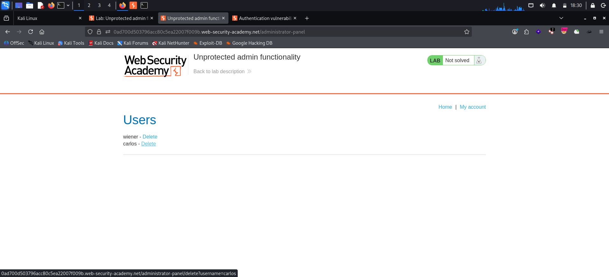
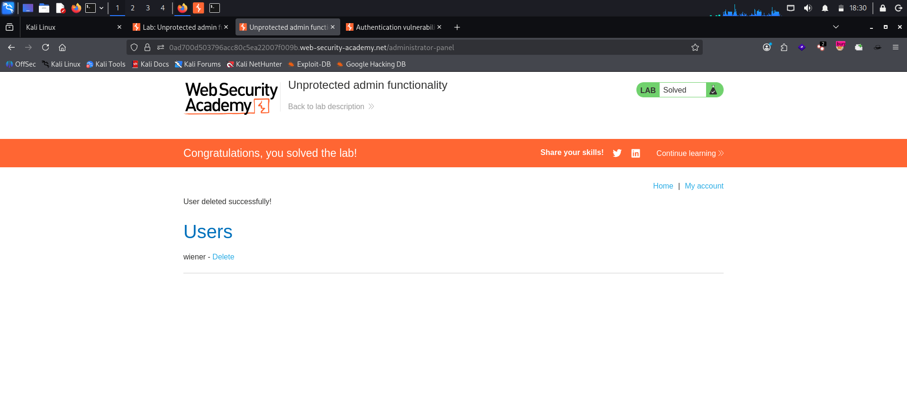

# Unprotected Admin Functionality

**Platform:** PortSwigger Web Security Academy  
**Category:** Access Control (Vertical Privilege Escalation)  
**Difficulty:** Apprentice  
**Date:** 2026-10-31

---

## 🎯 Objective

The lab has an admin panel with no access control. The goal is to find it and use it to delete the user `carlos`.

## 🔍 Recon & Analysis

The home page shows no link to an admin area, so the path had to be discovered.

A quick first check on any web target is `/robots.txt`. It tells search engines which paths not to crawl, so it often lists exactly the paths a developer wanted to hide.

```http
GET /robots.txt HTTP/2
Host: <lab-id>.web-security-academy.net
```

```
User-agent: *
Disallow: /administrator-panel
```

The `Disallow` line disclosed the admin panel path.

## 💥 Exploitation

1. Browsed directly to `/administrator-panel` as an unauthenticated user.
2. The page loaded the **Users** admin panel, listing `wiener` and `carlos` with **Delete** links. No login or role check was enforced.

   

3. Clicked **Delete** next to `carlos`, which sent:

   ```http
   GET /administrator-panel/delete?username=carlos HTTP/2
   Host: <lab-id>.web-security-academy.net
   ```

4. The server responded with *"User deleted successfully!"* and the lab was marked as solved.

   

## 🧠 Root Cause

- The admin panel relied on **security through obscurity**: the only protection was that its URL was not linked anywhere.
- No server-side check verified that the requester was an authenticated administrator before serving the panel or performing the delete action.
- `robots.txt` publicly disclosed the hidden path. It is a crawler hint, not a security control.

## 🛡️ Remediation

- Enforce **server-side authorization** on every admin route and action: check the session belongs to a user with the admin role, and **deny by default** (403).
- Protect state-changing actions such as delete with POST requests and CSRF tokens, not plain GET links.
- Never list sensitive paths in `robots.txt`. Treat a hidden or unpredictable URL as defense in depth only, never as access control.
- Where possible, restrict admin interfaces further, e.g. to an internal network or VPN.

## 📝 Key Takeaways

- Always check `/robots.txt`, `sitemap.xml` and JavaScript files during recon. They often leak hidden endpoints.
- A hidden URL is not a protected URL. If the server does not check *who* is asking, anyone who finds the path has admin access.
- This is **vertical privilege escalation**: a user with no privileges reached admin-only functionality.

## 🔗 References

- [PortSwigger: Access control vulnerabilities](https://portswigger.net/web-security/access-control)
- [OWASP Top 10 A01: Broken Access Control](https://owasp.org/Top10/A01_2021-Broken_Access_Control/)
- [OWASP Authorization Cheat Sheet](https://cheatsheetseries.owasp.org/cheatsheets/Authorization_Cheat_Sheet.html)
