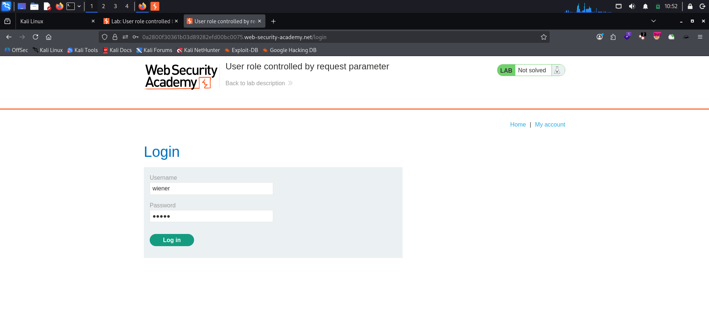
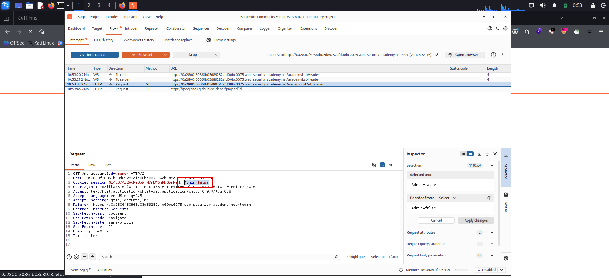
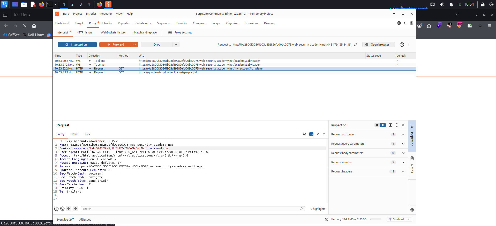
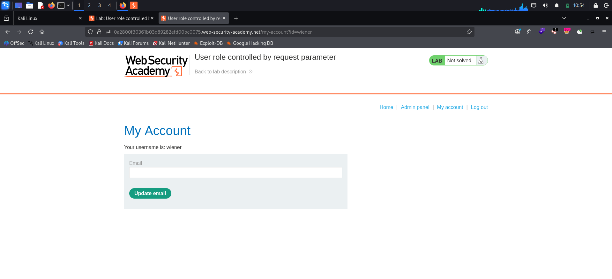
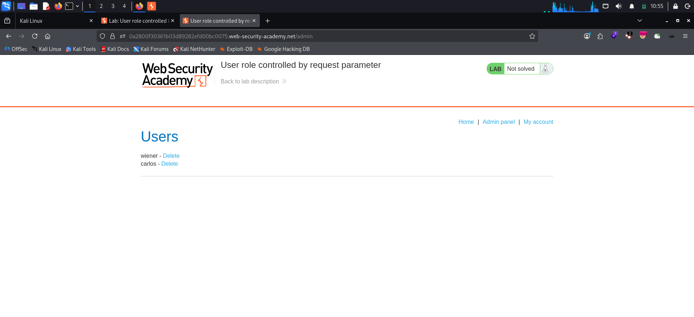
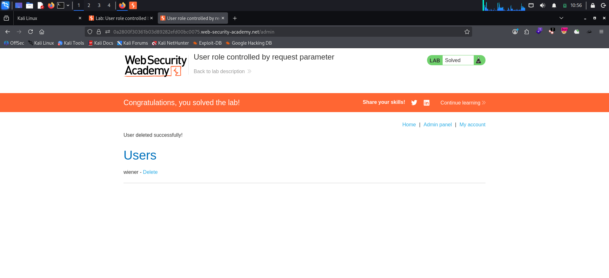

# User Role Controlled by Request Parameter

**Platform:** PortSwigger Web Security Academy
**Category:** Access Control
**Difficulty:** Apprentice
**Date:** 2026-11-02
**Severity:** High — a non-admin user forges a client-side cookie to gain admin access and delete another user.

---

## 🎯 Objective

The lab has an admin panel at `/admin` that decides who is an administrator using a **forgeable cookie**. The goal is to reach the admin panel as a low-privileged user and use it to delete the user `carlos`.

Provided credentials:

```
wiener:peter
```

---

## 🔍 Recon & Analysis

After logging in as `wiener`, the account page loads normally but there is **no "Admin panel" link** in the navigation — the low-privileged user is not shown admin functionality.




Browsing directly to `/admin` is also blocked for this user. So the access decision has to be coming from something the client sends. Intercepting traffic in Burp Proxy reveals the reason: the login flow sets an extra cookie alongside the session cookie, and every request to the app carries it:

```http
GET /my-account?id=wiener HTTP/2
Host: <lab-id>.web-security-academy.net
Cookie: session=[REDACTED]; Admin=false
```

The role is driven entirely by the client-controlled value `Admin=false`. Because the cookie lives in the browser, the user can edit it — classic **parameter-based access control** where the authorization flag is stored in a user-controllable location.



---

## 💥 Exploitation

**Step 1 — Flip the role flag.** With interception on, edit the `Cookie` header in the request and change `Admin=false` to `Admin=true`, then forward it:

```http
Cookie: session=[REDACTED]; Admin=true
```



**Step 2 — Confirm elevated access.** The server trusts the forged value, and the **"Admin panel"** link now appears in the navigation, pointing to `/admin`.



**Step 3 — Open the admin panel.** Browsing to `/admin` (again sending `Admin=true`) returns the Users page listing `wiener` and `carlos`, each with a **Delete** option.



**Step 4 — Delete carlos.** Triggering the delete sends a request like the one below; intercept it and make sure it carries `Admin=true` before forwarding:

```http
GET /admin/delete?username=carlos HTTP/2
Host: <lab-id>.web-security-academy.net
Cookie: session=[REDACTED]; Admin=true
```


The server processes the delete and the lab is solved.



> **Note:** The official solution flips the flag by intercepting the **login response** that sets `Admin=false` and changing it to `Admin=true`, so the browser stores the forged value for every later request. Editing the flag on each outgoing **request** (as shown above) achieves the same result — just keep an eye on the `Admin` value each time you forward, and avoid typos like `Admin=ture`.

---

## 🧠 Root Cause

- **Client-controlled authorization.** The user's role is decided by a cookie (`Admin`) that lives in the browser, so the attacker can set it to any value.
- **Trusting request data for access control.** The server reads the submitted flag at face value instead of deriving privileges from the authenticated session server-side.
- **No real authorization check on `/admin`.** The admin route and its actions rely only on the forgeable flag, not on a verified server-side role.

---

## 🛡️ Remediation

- Derive the user's role **server-side** from the authenticated session, never from a cookie, hidden field, or query parameter the client can edit.
- Enforce authorization on **every** admin route and every state-changing action (`/admin`, `/admin/delete`, …), denying by default.
- Don't rely on hiding the UI link as a control — hiding the "Admin panel" link is cosmetic, not security.
- Use POST + anti-CSRF tokens for destructive actions like deleting a user, instead of a bare `GET`.

---

## 📝 Key Takeaways

- Access control flags stored in **cookies / request parameters** are attacker-controlled and must never be trusted.
- When a privileged link is missing, check whether the role is being sent by the client — intercept the traffic and look for flags like `Admin`, `role`, or `isAdmin`.
- Flipping a single value (`false` → `true`) can be enough to escalate from a normal user to an administrator when the server does no real check.
- Server-side authorization is the only reliable control; anything the browser can edit is just a suggestion.

---

## 🔗 References

- [PortSwigger — User role controlled by request parameter](https://portswigger.net/web-security/access-control/lab-user-role-controlled-by-request-parameter)
- [PortSwigger — Access control vulnerabilities](https://portswigger.net/web-security/access-control)

---
