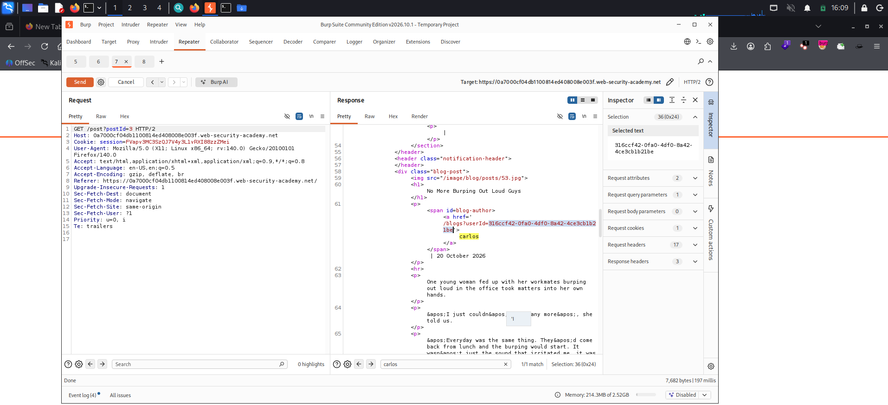
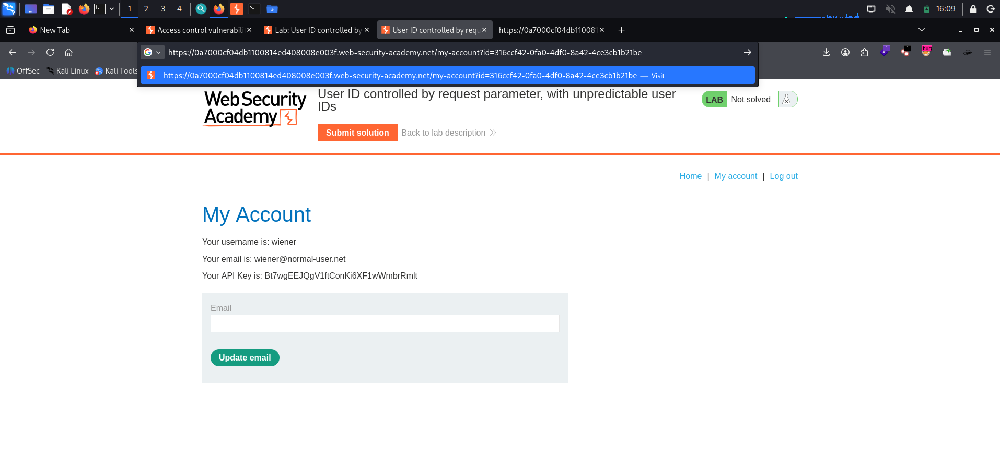
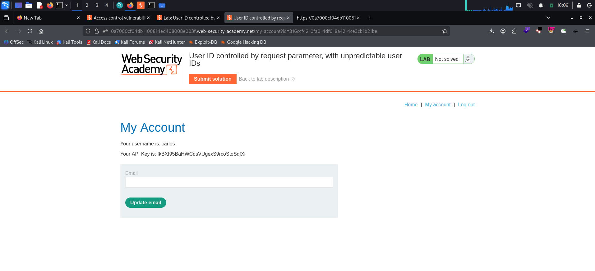
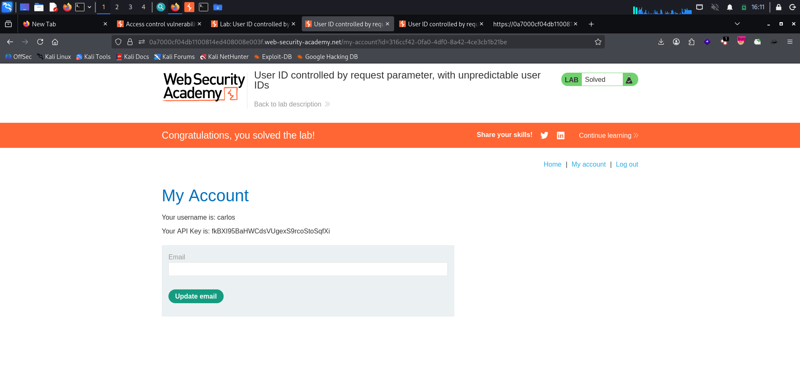

# User ID Controlled by Request Parameter, with Unpredictable User IDs

**Platform:** PortSwigger Web Security Academy
**Category:** Access Control (IDOR / Horizontal Privilege Escalation)
**Difficulty:** Apprentice
**Date:** 2026-11-04
**Severity:** High — the account page trusts a user-controlled `id` with no ownership check. The ID is a GUID rather than a guessable number, but it's disclosed elsewhere in the app, so another user's account (and API key) is still fully reachable.

---

## 🎯 Objective

The lab has a **horizontal privilege escalation** vulnerability on the user account page, but identifies users with **GUIDs** instead of predictable numbers. The goal is to find the GUID for `carlos` and submit his API key.

Own-account credentials: `wiener:peter`.

---

## 🔍 Recon & Analysis

Log in as `wiener` and open the account page. The URL carries the user identity in the `id` parameter — but this time it's a **GUID**, not a sequential number:

```
GET /my-account?id=<wiener-guid>
```

The account is selected purely from this client-supplied `id`, with no check that it belongs to the session — the same IDOR flaw as the predictable-ID version. The only extra hurdle is that you can't just guess carlos's GUID.

But a GUID that can't be guessed can still be **disclosed**. Applications routinely print user IDs wherever users are referenced — author links, messages, reviews. Browsing the blog, each post's **author link** points at `/blogs?userId=<guid>`, exposing that author's GUID.

Find a post written by **carlos** and read the author link — his GUID is right there in the `href`:



```
<a href="/blogs?userId=316ccf42-0fa0-4df0-8a42-4ce3cb1b21be">carlos</a>
```

So carlos's GUID is `316ccf42-0fa0-4df0-8a42-4ce3cb1b21be`.

---

## 💥 Exploitation

Take carlos's GUID and drop it into the account page's `id` parameter, replacing your own:

```
GET /my-account?id=316ccf42-0fa0-4df0-8a42-4ce3cb1b21be
```



The server returns **carlos's** account page — his username and his API key — even though we're logged in as wiener:



```
Your username is: carlos
Your API Key is: fkBXI95BaHWCdsVUgexS9rcoStoSqfXi
```

Submitting carlos's API key solves the lab:



> **Note:** the GUID and API key are unique to this ephemeral lab instance and are regenerated each time it's spun up.

---

## 🧠 Root Cause

- **No ownership check on the object reference.** The account handler fetches whatever account the `id` names, without confirming it belongs to the session. Swapping the GUID is enough.
- **Unpredictable ≠ secret.** GUIDs stop *guessing*, but they don't stop *access*. The ID is leaked through ordinary features (blog author links), so the "unpredictability" protection is defeated by disclosure.
- **Identity taken from the request, not the session.** A "my account" page should derive the user from the authenticated session, never from a client-supplied value.

---

## 🛡️ Remediation

- **Enforce an authorization check on every object access.** Before returning the account, verify the `id` matches (or is allowed for) the session user — deny by default. This is what actually fixes the bug.
- **Derive identity from the session.** For own-account pages, ignore any client-supplied `id` and serve the account bound to the session.
- **Don't rely on unguessable IDs as a control.** Unpredictable identifiers are defense-in-depth, not access control — especially when the same IDs are printed elsewhere in the app.
- **Minimize ID disclosure.** Avoid exposing internal user identifiers in author links, messages, and reviews where they aren't needed.

---

## 📝 Key Takeaways

- An `id` parameter holding a **GUID** is still worth testing for IDOR — unpredictability only matters if the value is also kept secret, and it usually isn't.
- When you need another user's "unguessable" ID, **look where users are referenced**: author links, comments, reviews, shared messages. The app often hands it to you.
- The fix is always the **authorization check on the object**, not swapping sequential IDs for random ones.

---

## 🔗 References

- [PortSwigger — User ID controlled by request parameter, with unpredictable user IDs](https://portswigger.net/web-security/access-control/lab-user-id-controlled-by-request-parameter-with-unpredictable-user-ids)
- [PortSwigger — Insecure direct object references (IDOR)](https://portswigger.net/web-security/access-control/idor)
- [OWASP — Authorization Cheat Sheet](https://cheatsheetseries.owasp.org/cheatsheets/Authorization_Cheat_Sheet.html)

---
