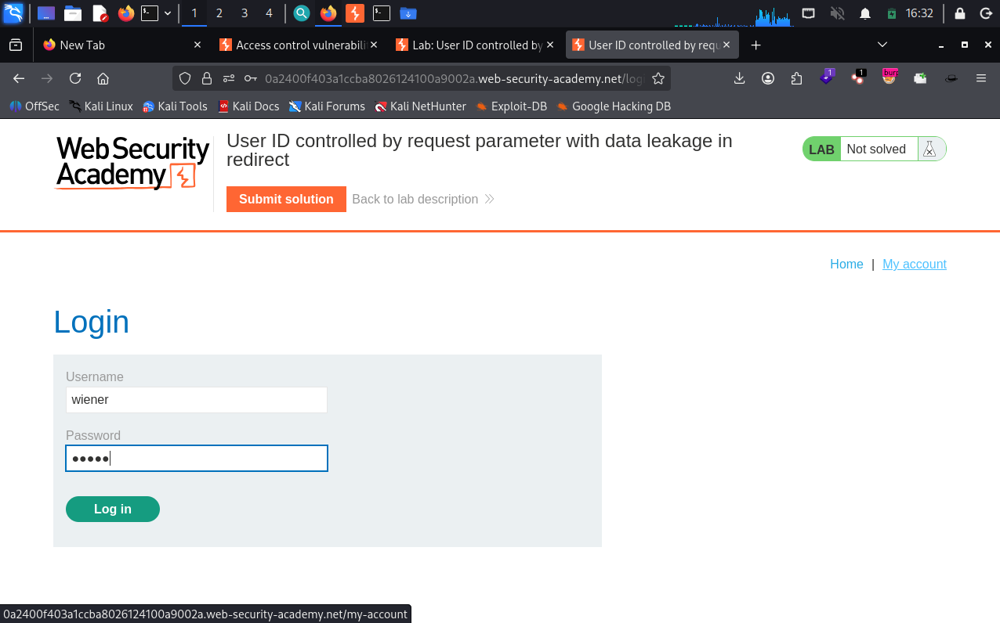
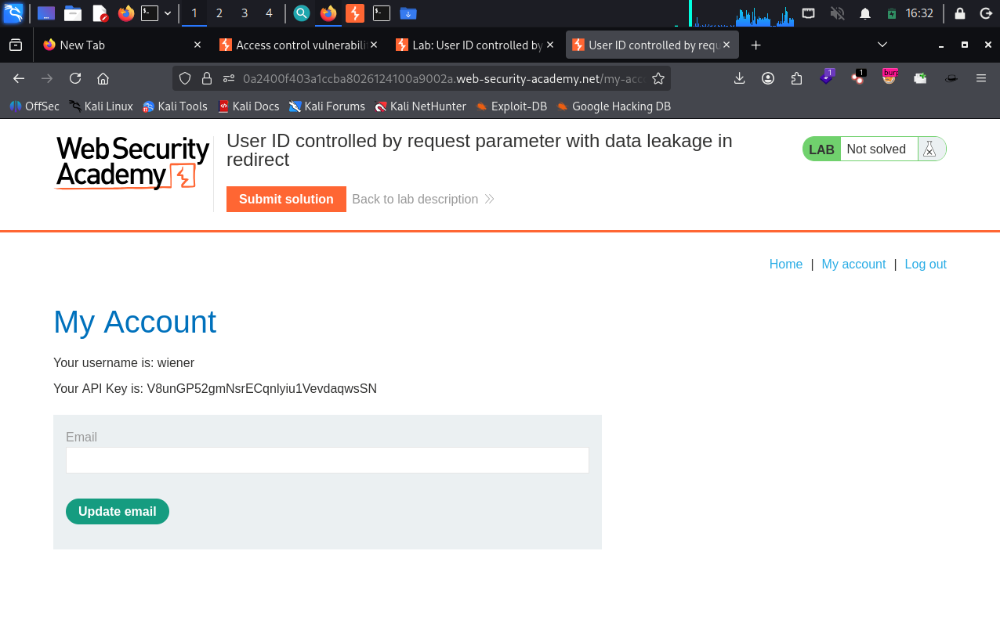
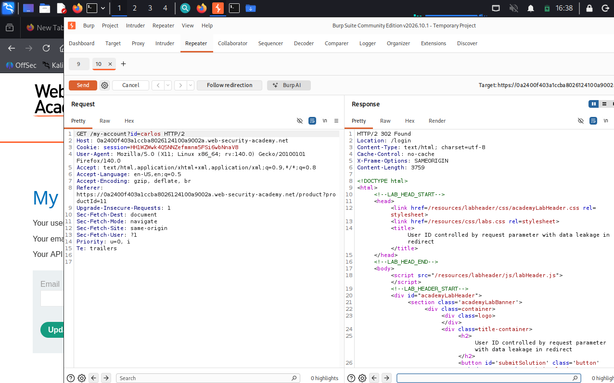
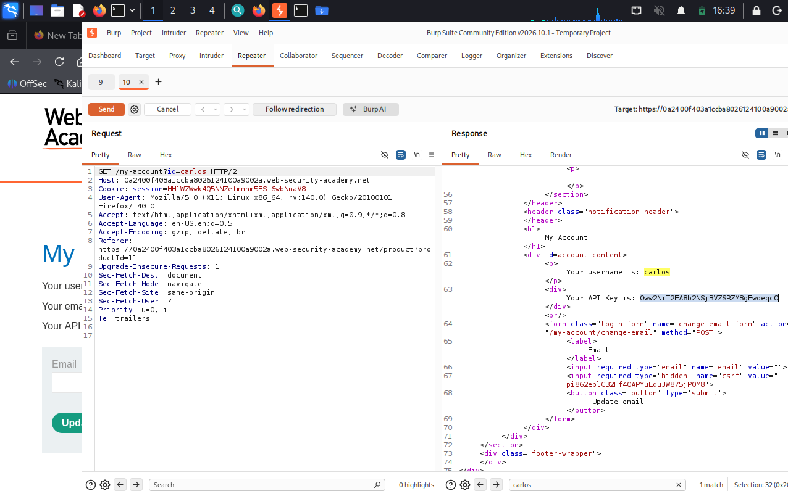
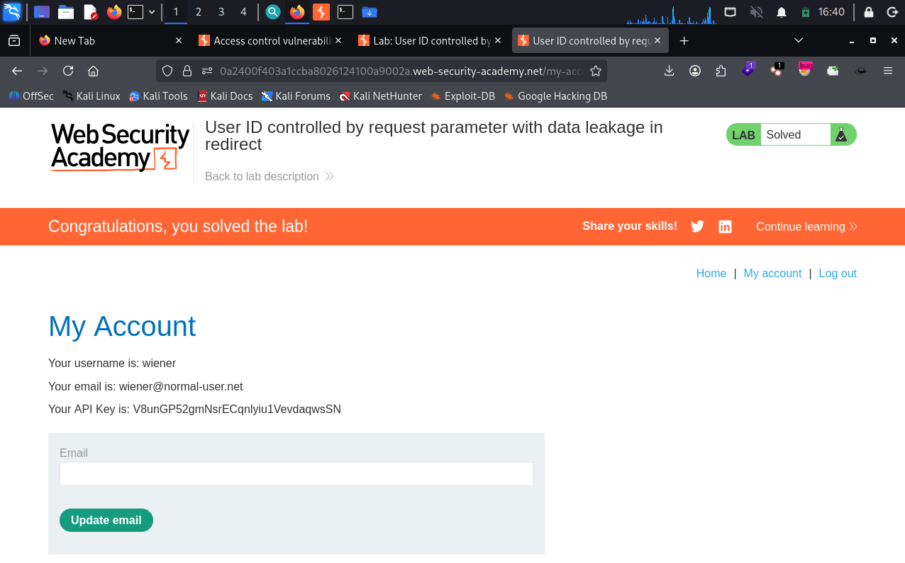

# User ID Controlled by Request Parameter with Data Leakage in Redirect

**Platform:** PortSwigger Web Security Academy
**Category:** Access Control (IDOR / Horizontal Privilege Escalation)
**Difficulty:** Apprentice
**Date:** 2026-11-04
**Severity:** High — the account page *does* detect unauthorized access and redirects to login, but the redirect response still ships the target user's data in its body, so the access control is effectively bypassed.

---

## 🎯 Objective

The lab has an access control vulnerability where **sensitive information is leaked in the body of a redirect response**. The goal is to obtain the API key for `carlos` and submit it.

Own-account credentials: `wiener:peter`.

---

## 🔍 Recon & Analysis

Log in as `wiener`:



The account page loads at `/my-account?id=wiener` — identity is taken from the client-supplied `id` parameter, and the page prints the user's API key:



That's the familiar IDOR shape. The twist here: this app actually **checks** whether you're allowed to view the requested account. The interesting question is *what the check does* when it fails.

Send the request to Burp Repeater and change `id=wiener` to `id=carlos`:

```http
GET /my-account?id=carlos HTTP/2
Host: <lab-id>.web-security-academy.net
Cookie: session=<WIENER-SESSION>
```

This time the response is **`302 Found` → `Location: /login`** — the app has noticed we aren't carlos and is bouncing us to the login page:



A browser would follow that redirect and we'd never see carlos's page. But the redirect **isn't empty** — the `302` response still carries a full HTML body (note the non-zero `Content-Length`).

---

## 💥 Exploitation

The access check blocks the *navigation* but not the *data*: the handler builds carlos's account page, then slaps a redirect on top without stripping the body. In Repeater we see the raw response, redirect and all, so we just read the body.

Scroll/search the `302` response body — carlos's username and API key are sitting right there:



```
Your username is: carlos
Your API Key is: Oww2NiT2FA8b2NSjBVZSRZM3gFwqeqcO
```

Submit carlos's API key to solve the lab:



> **Note:** the API key is unique to this ephemeral lab instance and is regenerated each time it's spun up.

---

## 🧠 Root Cause

- **The check gates the redirect, not the data.** The server decides the user is unauthorized and sets a `302` to `/login`, but it still renders the target account and returns it as the response body. The authorization decision never actually prevents the sensitive data from being sent.
- **Relying on the browser to enforce the control.** A redirect only "works" if the client follows it and discards the body. An attacker reading the raw response (Burp, curl) ignores the redirect entirely.
- **Identity from the request.** As with every IDOR here, the account is chosen by a client-controlled `id` instead of the session.

---

## 🛡️ Remediation

- **Stop processing on an authorization failure — don't just redirect.** When the check fails, return immediately with an empty body (and an appropriate status such as `302` to login or `403`); never build and attach the protected resource.
- **Separate the authorization check from rendering.** Authorize *before* fetching or rendering the account, so unauthorized requests never touch the sensitive data.
- **Derive identity from the session**, not from a client-supplied `id`, for own-account pages.
- **Treat redirects as non-security.** A redirect is a client hint, not an access control; the body of any response to an unauthorized request must contain nothing sensitive.

---

## 📝 Key Takeaways

- A `302`/redirect is **not** proof that access was denied — always check the **response body**. Servers often redirect *and* leak.
- Burp Repeater / curl see the raw response and don't auto-follow redirects, so they reveal data a browser would silently throw away. This is why you test IDOR in Repeater, not just the browser.
- Authorization must **short-circuit** the request before the protected data is ever assembled; bolting a redirect onto an already-rendered response is not a control.

---

## 🔗 References

- [PortSwigger — User ID controlled by request parameter with data leakage in redirect](https://portswigger.net/web-security/access-control/lab-user-id-controlled-by-request-parameter-with-data-leakage-in-redirect)
- [PortSwigger — Insecure direct object references (IDOR)](https://portswigger.net/web-security/access-control/idor)
- [OWASP — Authorization Cheat Sheet](https://cheatsheetseries.owasp.org/cheatsheets/Authorization_Cheat_Sheet.html)

---
