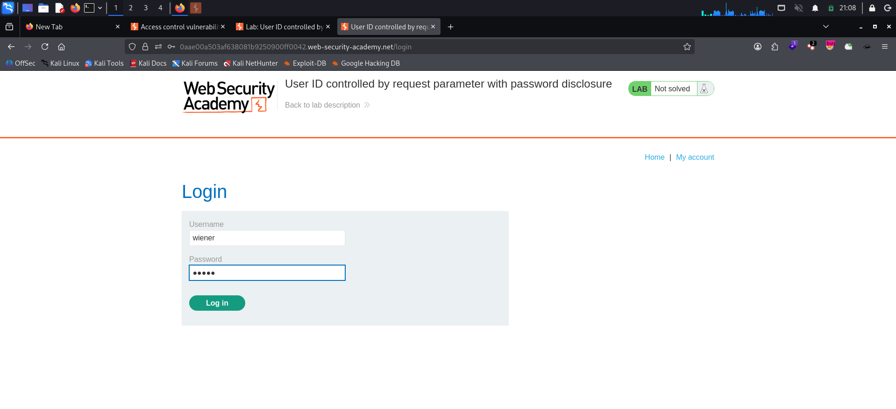
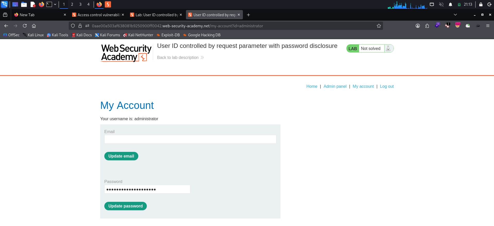
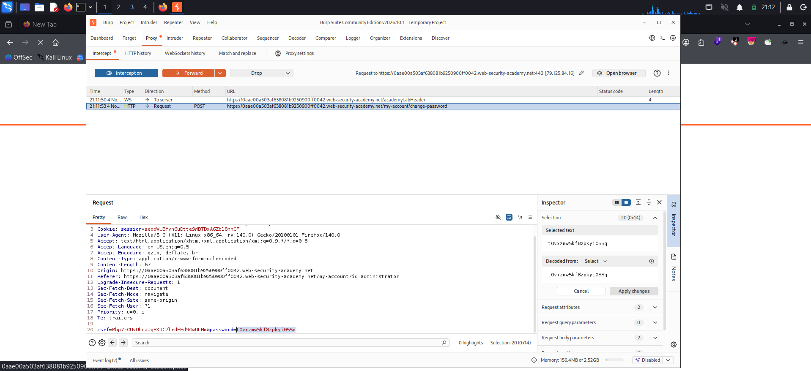
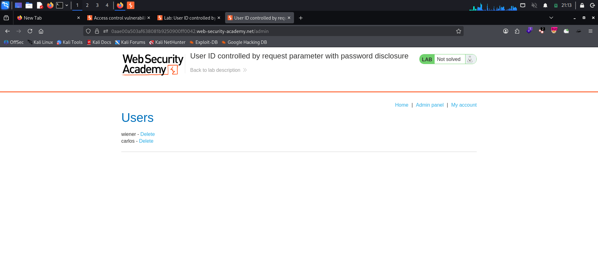
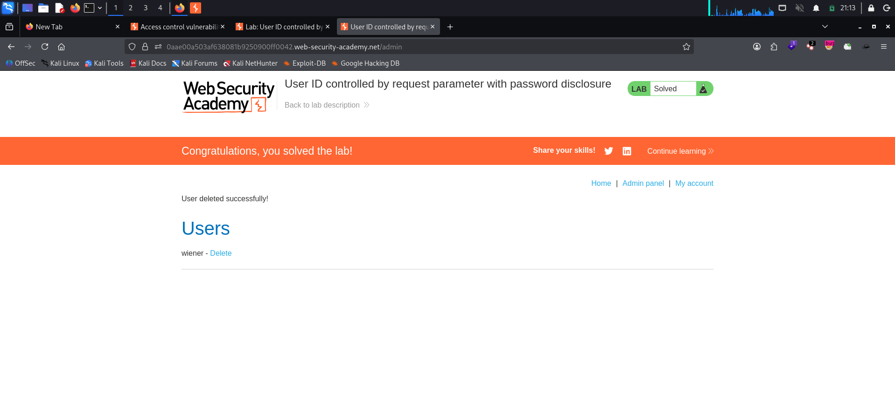

# User ID Controlled by Request Parameter with Password Disclosure

**Platform:** PortSwigger Web Security Academy
**Category:** Access Control (IDOR → Vertical Privilege Escalation)
**Difficulty:** Apprentice
**Date:** 2026-11-04
**Severity:** Critical — any logged-in user can read the administrator's plaintext password from the account page, log in as admin, and use the admin panel.

---

## 🎯 Objective

The lab's account page shows the current user's existing password, prefilled in a masked `<input type="password">`. The goal is to retrieve the **administrator's** password, log in as administrator, and use the admin panel to delete the user `carlos`.

Own-account credentials: `wiener:peter`.

---

## 🔍 Recon & Analysis

Log in as `wiener`:



The account page loads at `/my-account?id=wiener`. Two things stand out:

1. The account is chosen by the client-supplied `id` parameter — the usual IDOR shape.
2. The "Update password" form has the user's **current password prefilled** in a masked field. Masking only hides it on screen; the real value is sitting in the HTML `value=""` attribute.

So if the `id` parameter isn't tied to the session, changing it should hand us someone else's password.

---

## 💥 Exploitation

### 1. Load the administrator's account page

Change `id=wiener` to `id=administrator`:

```http
GET /my-account?id=administrator HTTP/2
Host: <lab-id>.web-security-academy.net
Cookie: session=<WIENER-SESSION>
```

The server happily renders the administrator's account page for wiener's session — the page shows **"Your username is: administrator"** and the password field is filled with a long masked value:



### 2. Read the masked password

The password is masked in the browser, but it's in the response. Either:

- view the response in **Burp** (Proxy → HTTP history / Repeater) and look for the `password` input's `value`, or
- inspect the field in DevTools, or
- with Intercept on, click **Update password** — the form submits the prefilled value in cleartext:

```http
POST /my-account/change-password HTTP/2
Referer: https://<lab-id>.web-security-academy.net/my-account?id=administrator
Content-Type: application/x-www-form-urlencoded

csrf=<CSRF-TOKEN>&password=t0vxzmw5kf8zpkyi055q
```



Administrator password: `t0vxzmw5kf8zpkyi055q`

> **Note:** drop this request rather than forwarding it — we only needed to read the value. The password is unique to this ephemeral lab instance.

### 3. Log in as administrator and delete carlos

Log out, log in with `administrator:t0vxzmw5kf8zpkyi055q`. An **Admin panel** link now appears. Open `/admin`:



Click **Delete** next to `carlos`:

```http
GET /admin/delete?username=carlos HTTP/2
Cookie: session=<ADMIN-SESSION>
```

"User deleted successfully!" — the lab is solved:



---

## 🧠 Root Cause

- **Identity from the request, not the session.** `/my-account` trusts the `id` parameter to decide whose data to render, with no check that it matches the logged-in user. That's a horizontal IDOR.
- **Horizontal becomes vertical.** Because one of the reachable accounts is `administrator`, reading "another user's" page escalates straight to full admin access.
- **Sending the password back to the client at all.** Prefilling the current password means the server stores it recoverably (plaintext or reversible) and ships it in every account-page response. `type="password"` is a display mask, not protection — the value is in the HTML, in proxies, in caches and in the browser.

---

## 🛡️ Remediation

- **Derive the account from the session.** Own-account pages should ignore any client-supplied user ID; if an `id` must exist (e.g. for admins), enforce a server-side authorization check on every request.
- **Never return existing passwords.** Don't prefill password fields. A password-change form should ask for the *current* password as input and verify it, not display it.
- **Store passwords as salted, slow hashes** (bcrypt, scrypt, Argon2) so the server *can't* return the plaintext even if it wanted to.
- **Protect high-value accounts further** — MFA for admins and re-authentication for sensitive actions like deleting users limit the damage of a leaked password.

---

## 📝 Key Takeaways

- Masked inputs (`type="password"`) hide data from the eye, not from the response. Always check the raw HTML/response in Burp.
- When testing IDOR, try privileged usernames (`administrator`, `admin`, `root`) — an IDOR on the right account is a full vertical privilege escalation.
- Any page that echoes a secret back to the client is a disclosure waiting for an access control bug to expose it.

---

## 🔗 References

- [PortSwigger — User ID controlled by request parameter with password disclosure](https://portswigger.net/web-security/access-control/lab-user-id-controlled-by-request-parameter-with-password-disclosure)
- [PortSwigger — Access control vulnerabilities](https://portswigger.net/web-security/access-control)
- [OWASP — Password Storage Cheat Sheet](https://cheatsheetseries.owasp.org/cheatsheets/Password_Storage_Cheat_Sheet.html)
- [OWASP — Authorization Cheat Sheet](https://cheatsheetseries.owasp.org/cheatsheets/Authorization_Cheat_Sheet.html)
